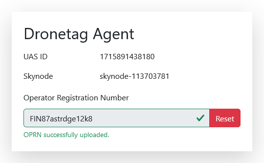

# Dronetag Agent

The Dronetag Agent is an [Auterion App][auterion-app] enabling the use of a [Dronetag DRI][dronetag-dri] module on a [Skynode][skynode] platform.

[auterion-app]: https://docs.auterion.com/app-development/app-framework
[dronetag-dri]: https://dronetag.com/products/dri/
[skynode]: https://auterion.com/product/skynode-x/

See the following pages for more information:

- [Installation](docs/installation.md) for a step-by-step guide on how to install the Dronetag Agent on a Skynode.
- [MAVLink](docs/mavlink.md) for an overview of the MAVLink messages used by the Dronetag Agent and some notes on application architecture.
- [Operator Registration Number](docs/operator-registration-number.md) for some notes on the UAS Operator Registration Number (OPRN).
