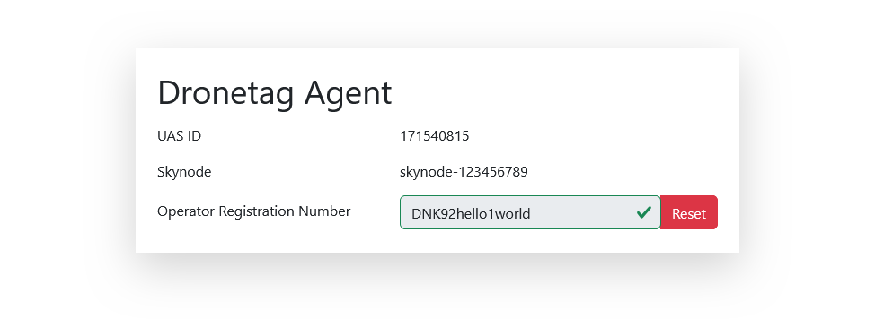

---
hide:
  - navigation
  - toc
---

# Dronetag Agent { style="display: none;" }

<figure markdown="span">
  
  <!-- <figcaption>Dronetag Agent Web UI</figcaption> -->
</figure>

The Dronetag Agent is an [Auterion App][auterion-app] enabling the use of a [Dronetag DRI][dronetag-dri] module
on a [Skynode][skynode] platform.

[auterion-app]: https://docs.auterion.com/app-development/app-framework
[dronetag-dri]: https://dronetag.com/products/dri/
[skynode]: https://auterion.com/product/skynode-x/

The documentation is split into three parts:

- a [User Manual](manual/index.md) for operators and end-users (will be added to the Operating Manual as well)
- a [Technical Documentation](tech-docs/index.md) for developers and third parties
- a [Setup Guide](setup/index.md) containing instructions on how to setup, configure and install the DRI system on a HIGHDRA
