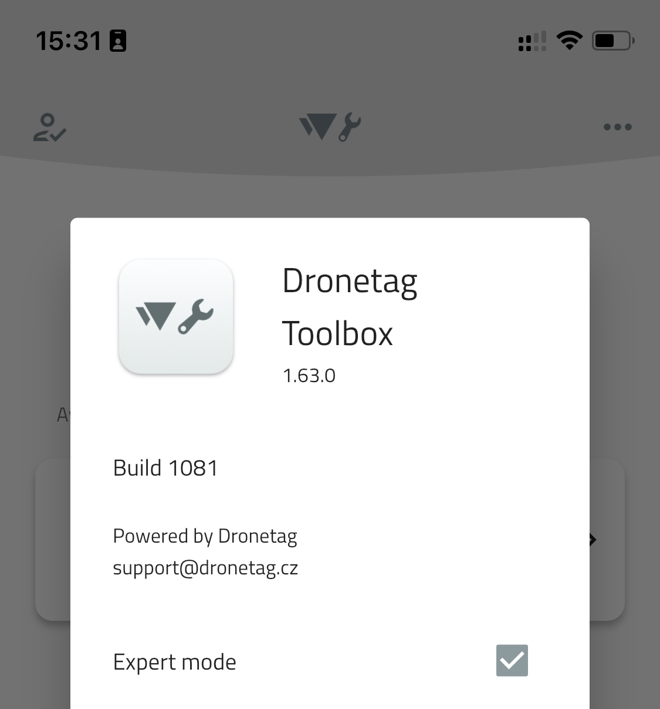
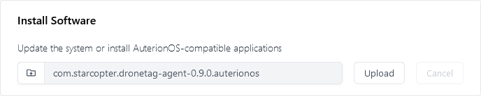
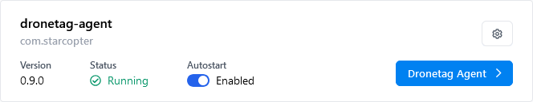
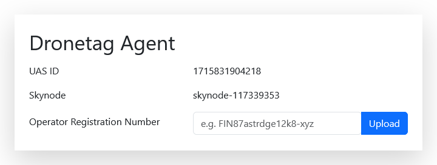
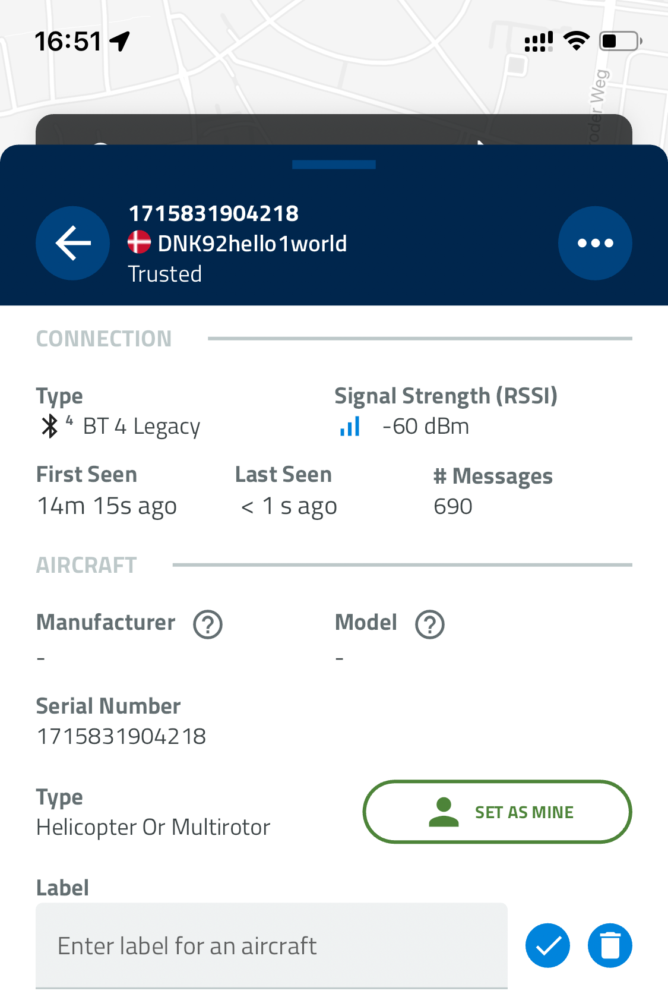

# Installation

Follow the steps below to integrate a Dronetag DRI module into a starcopter HIGHDRA.

You'll need:

- A [Dronetag DRI][dronetag-dri] module
- A [Skynode][skynode]
- Either an Auterion [Pixhawk Adapter Board][pixhawk-adapter-board] or a [HIGHDRA Motherboard][highdra-motherboard]
- Power supply for the Skynode
- An iOS or Android device
- A laptop with [Auterion Mission Control][auterion-mission-control] installed

[dronetag-dri]: https://dronetag.com/products/dri/
[skynode]: https://auterion.com/product/skynode-x/
[pixhawk-adapter-board]: https://docs.auterion.com/hardware-integration/skynode/peripherals/adapter-boards
[highdra-motherboard]: https://starcopter.365.altium.com/designs/Manufacturing-Portal-8E6B5FC2-9B71-4BE3-BA49-3EF18DDFBC37?projectSourceGuid=76877CFA-931F-420B-BA06-544F94C40255&variant=Prototype#design
[auterion-mission-control]: https://auterion.com/product/mission-control/

## Setup

Connect the DRI module to the Skynode's **TELEM1** port.
On an Auterion Pixhawk Adapter Board this is **J12** (labeled TELEM1),
on a HIGHDRA Motherboard this is **J20** in the 7 o'clock position on the bottom side of the board.

Power the Skynode. The LED on the DRI module should light up yellow.

## DRI Module Configuration



Install the Dronetag Toolbox app on your iOS or Android device ([App Store][dtt-app-store], [Google Play][dtt-google-play]).

[dtt-app-store]: https://apps.apple.com/us/app/dronetag-toolbox/id6443763841?platform=iphone
[dtt-google-play]: https://play.google.com/store/apps/details?id=cz.dronetag.toolbox

Inside the Dronetag Toolbox app, press the three dots in the top right corner and select **About**.
In the dialog that appears, **press and hold** the logo for two seconds -- advanced settings will appear.
Select the checkbox for **Expert mode** and close the dialog.

On the home screen, select the Dronetag DRI module to configure it.
Select the **Configuration** menu, and make sure the configuration is as follows:

| Parameter                   | Value       |
| --------------------------- | ----------- |
| Enable MAVlink flight start | enabled     |
| Enable Direct Remote ID     | enabled     |
| Static data frequency       | 2 Hz        |
| Dynamic data frequency      | 2 Hz        |
| GNSS input                  | MAVLink     |
| Pressure data input         | MAVLink     |
| Request Messages            | enabled     |
| MAVLink Integration Type    | OpenDroneID |
| Controller Port Baud Rate   | 115200      |
| Forward Port Baud Rate      | 115200      |

If you had to change any of these settings, press **Save** to apply the changes.
Go back to the device configuration screen and select the **Advanced Configuration** menu.

Expand the **mavlink** section and set the **mavlink/system** parameter to **2**.
Save this change by tapping the three dots in the top right corner and selecting **Save**.

With these steps completed, the DRI module should be ready to use.

## Skynode Configuration

Connect your laptop to the Skynode (via WiFi or USB-C).

### PX4

Open Auterion Mission Control. When the Skynode is connected properly to your laptop, AMC will automatically detect it.
Enter [Advanced Mode][amc-advanced-mode] and navigate to the **Advanced** --> **Parameters** tab.

[amc-advanced-mode]: https://docs.auterion.com/hardware-integration/flight-controller-customization/amcs-advanced-mode#enable-advanced-mode-in-amc

Ensure the following parameters are configured correctly:

| Parameter          | Value         |
| ------------------ | ------------- |
| `MAV_0_CONFIG`     | TELEM1        |
| `MAV_0_FLOW_CTRL`  | Auto-detected |
| `MAV_0_FORWARD`    | Enabled       |
| `MAV_0_MODE`       | Normal        |
| `MAV_0_RADIO_CTRL` | Disabled      |
| `MAV_0_RATE`       | 1200 B/s      |
| `MAV_S_FORWARD`    | Enabled       |
| `SER_TEL1_BAUD`    | 115200 8N1    |

### AuterionOS

With the Skynode still connected to your laptop, open a terminal window and SSH into the Skynode.
The IP address depends on the connection method:

| Connection | IP Address |
| ---------- | ---------- |
| WiFi       | 10.41.0.1  |
| USB-C      | 10.41.1.1  |

If it has not been changed, the password is `auterion`.

```shell
$ ssh root@10.41.0.1
root@10.41.0.1's password:
Last login: Fri Dec 20 15:55:10 2024 from 10.41.0.2

    /\        | |          (_)
   /  \  _   _| |_ ___ _ __ _  ___  _ __
  / /\ \| | | | __/ _ \ '__| |/ _ \| '_ \
 / ____ \ |_| | ||  __/ |  | | (_) | | | |
/_/    \_\__,_|\__\___|_|  |_|\___/|_| |_|


Hello, Big Blue Sky!
      IP: 172.19.0.1 172.18.0.1 192.168.144.25 10.0.0.1 10.41.10.1 10.41.0.1
    UUID: 117339353
 FC UUID: uid2:000200000000393037363138510d0025001c
root@skynode-117339353:~#
```

Once logged in, deactivate Auterion's own Remote ID agent to prevent it from interfering with the DRI module:

```shell
$ mountrw  # to mount the root filesystem in read-write mode
$ systemctl disable remoteid-agent --now
Removed /etc/systemd/system/multi-user.target.wants/remoteid-agent.service.
$ mountro  # mount root filesystem in read-only mode
```

> ⚠️ **Attention:** This step needs to be repeated every time AuterionOS is up- or downgraded!

## Install Dronetag Agent

Before continuing, reboot Skynode to make sure all the changes take effect. Note that this will also restart the Dronetag DRI module.

Head over to the [Releases Page][dronetag-agent-releases] and download the latest version of the Dronetag Agent (`.auterionos` file).
Open the AuterionOS web interface in your browser ([10.41.0.1](http://10.41.0.1/) for WiFi, [10.41.1.1](http://10.41.1.1/) for USB-C).
In the **Install Software** section, select the `.auterionos` file you downloaded and click **Upload**.



Wait for the installation to complete, then click on the **Apps** tab in the left sidebar.
You should see the Dronetag Agent in the list of installed user applications.



Click the blue **Dronetag Agent >** button to open the application user interface.
If you see the following, the Dronetag Agent is working correctly:



[dronetag-agent-releases]: https://github.com/starcopter/dronetag-agent/releases/latest

## Drone Scanner



Install the Drone Scanner app ([App Store][drone-scanner-app-store], [Google Play][drone-scanner-google-play]) on your mobile device.

[drone-scanner-app-store]: https://apps.apple.com/us/app/drone-scanner/id1644548782
[drone-scanner-google-play]: https://play.google.com/store/apps/details?id=cz.dronetag.dronescanner

Open the Drone Scanner app: you should see the HIGHDRA right next to you!
