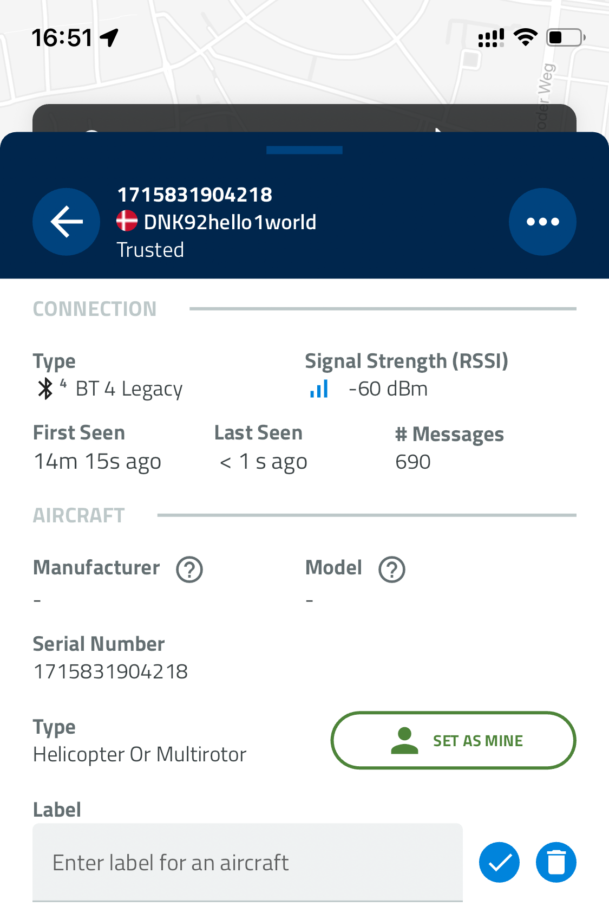

# Validation

The Dronetag Agent's purpose is to enable Direct Remote ID (DRI) on the HIGHDRA.

Its functionality can be verified by using the Drone Scanner app.

## Drone Scanner App

The Drone Scanner is a free mobile app developed by Dronetag, available for both iOS and Android.
It is available from the [:simple-appstore: App Store][drone-scanner-app-store]
and [:simple-googleplay: Google Play][drone-scanner-google-play], depending on your device.

[drone-scanner-app-store]: https://apps.apple.com/us/app/drone-scanner/id1644548782
[drone-scanner-google-play]: https://play.google.com/store/apps/details?id=cz.dronetag.dronescanner

While the drone is in range, the Drone Scanner app will automatically detect it.
Information like the drone's serial number, location and operational status will be displayed.
When the OPRN is [correctly uploaded](index.md#uploading-the-oprn), its public part will be visible too.

## Troubleshooting

If the drone is not detected, there are a few things to check:

- Is the drone powered on and in close range?
- Does the Drone Scanner app have access to Bluetooth?
- Is Bluetooth enabled on the mobile device?
- Is the OPRN [correctly uploaded](index.md#uploading-the-oprn)?

If the problem persists, please try the following steps:

1. Restart the drone.
2. Close and reopen the Drone Scanner app.
3. Re-install the Drone Scanner app.
4. Try a different mobile device.
5. [Contact starcopter][support-email].

[support-email]: mailto:support@starcopter.com?subject=Dronetag%20Agent%20Issue
