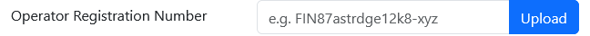
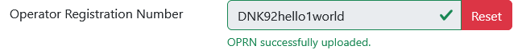
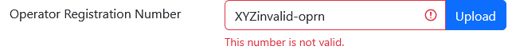
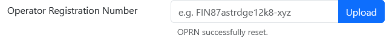

# User Manual

To allow the operator to upload their Operator Registration Number (OPRN),
the Dronetag Agent has a simple web UI that is accessible from the remote control.

!!! info "Operator Registration Number required"

    Only with a valid OPRN uploaded can the drone be operated legally in the OPEN category!

## Accessing the Web UI

The web UI address depends on the Skynode's network configuration,
which in turn depends on the remote controller being used.

### Herelink

With the Herelink controller, the Dronetag Agent web UI is available at the following address:

[http://192.168.144.20/apps/com.starcopter.dronetag-agent/](http://192.168.144.20/apps/com.starcopter.dronetag-agent/)

### Skynode WiFi

When directly connected to the Skynode via WiFi, use the following address:

[http://10.41.0.1/apps/com.starcopter.dronetag-agent/](http://10.41.0.1/apps/com.starcopter.dronetag-agent/)

## Uploading the OPRN

The web UI has a prominent input field for the OPRN.

Into this field, the operator can type their OPRN and click the "Upload" button to upload it to the drone.
This needs to be done only once, the drone will remember the OPRN once it has been uploaded.

!!! note "Operator Registration Number"

    The Operator Registration Number (OPRN) is a unique identifier for the operator.
    It consists of a three-charactor country code, followed by 13 _public_ alphanumeric characters
    and a _private_ part consisting of three alphanumeric characters.

    The complete OPRN has to be entered into the input field, but only the public part will be displayed.
    The private part should not be shared with anyone!

The Dronetag Agent will check the OPRN upon upload.
If it is not valid, the upload will fail, and an error message will be displayed.
This can be due to a number of reasons:

- The country code is invalid, or not from an [EU member state][eu-member-states].
- The format of the OPRN is invalid.
- The private part is missing.
- The built-in checksum does not match.

[eu-member-states]: https://eur-lex.europa.eu/legal-content/EN/TXT/?uri=LEGISSUM:member_states

## Resetting the OPRN

When the drone is returned to starcopter, or a new operator takes over,
the OPRN needs to be reset by pressing the big, red "Reset" button.

This will clear the OPRN from the drone's memory.
