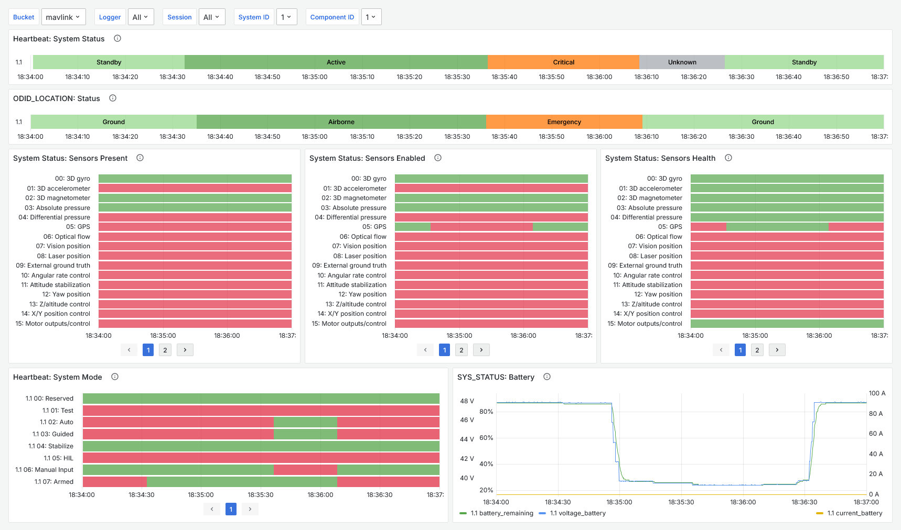
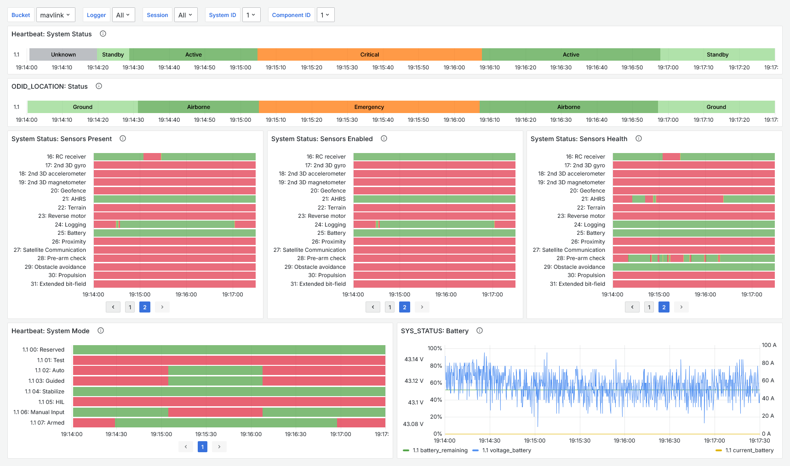
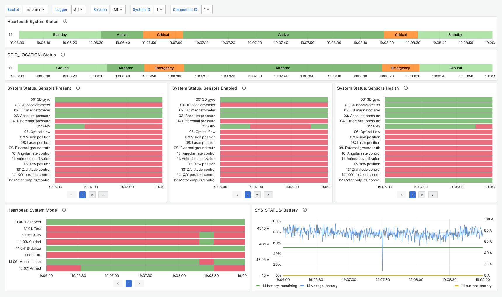

# MAVLink Message Overview

According to [Dronetag DRI integration docs][dronetag-dri-mavlink-integration], the DRI module requires the following MAVLink messages:

- ALTITUDE
- GPS_RAW_INT
- SYSTEM_TIME
- GLOBAL_POSITION_INT
- OPEN_DRONE_ID_BASIC_ID
- OPEN_DRONE_ID_LOCATION
- OPEN_DRONE_ID_SYSTEM
- OPEN_DRONE_ID_OPERATOR_ID

The DRI module sends the following messages:

- OPEN_DRONE_ID_ARM_STATUS

[dronetag-dri-mavlink-integration]: https://help.dronetag.com/dronetag-dri/integration#mavlink-integration

## Architecture

There are two (relevant) systems and corresponding MAVLink subnets on the drone:

- PX4 Autopilot, System ID 1
- DRI Module, System ID 2

Inside each system, there are two components relevant to this project:

- Autopilot, Component ID 1 (`MAV_COMP_ID_AUTOPILOT1`)
- DRI Module, Component ID 236 (`MAV_COMP_ID_ODID_TXRX_1`)

The Dronetag Agent (this application) acts as bridge, connecting MAVLink subnets 1 and 2.

### PX4 Autopilot

### DRI Module

## Messages

| Message | ID | PX4 | Dronetag Agent | DRI Module | Notes |
| --- | --- | --- | --- | --- | --- |
| **SYSTEM_TIME** | 2 | publish | forward | receive | |
| **GPS_RAW_INT** | 24 | publish | forward | receive | |
| **GLOBAL_POSITION_INT** | 33 | publish | forward | receive | |
| **ALTITUDE** | 141 | publish | forward | receive | contains pressure altitude for ODID_LOCATION message, not sure if used |
| **HOME_POSITION** | 242 | publish | receive | | contains information for ODID_SYSTEM message |
| **ODID_BASIC_ID** | 12900 | publish | drop; publish | receive | PX4 sends this message, but it contains the wrong UAS ID. Dronetag Agent sends its own message with UAS ID from environment variable. |
| **ODID_LOCATION** | 12901 | publish | forward | receive | does not need to be patched with emergency status 🎉 |
| **ODID_SYSTEM** | 12902 | | publish | receive | filled with takeoff location from HOME_POSITION message |
| **ODID_OPERATOR_ID** | 12903 | | publish | receive | operator ID from web app |
| **ODID_ARM_STATUS** | 12904 | receive | forward | publish | |

### Basic ID

The Basic ID message includes the ID type, UA type, and the unique ID.
This unique ID shall contain the manufacturer serial number of the UA.

| Field | Type | (Sample) Value | Notes |
| --- | --- | --- | --- |
| ID Type | byte | 1 | enum: serial number |
| UA Type | byte | 2 | enum: helicopter or multirotor |
| UAS ID | byte[20] | 1715800000000 | serial number |

### Location

The location/vector message is used to transmit the UA mandatory information such as “track
direction”, “speed over ground”, “latitude”, “longitude”, “height”, and the “timestamp”.

## Operational Status

The **ODID_LOCATION** message contains a field for operational status. As per EN 4709-002, this can have the following values:

- 0: Undeclared
- 1: Ground
- 2: Airborne
- 3: Emergency

PX4 publishes this message, but its emergency status bit is not always set correctly.
Therefore, the Dronetag Agent patches the message with the correct operational status in case of emergency.

EN 4709-002 specifies the following:

> UAS operational status of UA shall be set to Emergency (3) when partial or full loss of control of the flight trajectory occurs.  
> This may happen in case of:
>
> - low battery;
> - loss of C2;
> - loss of GNSS.

The following sections describe how to detect each of these conditions from available MAVLink messages.

### Low Battery

When the battery percentage drops below the configured critical battery threshold [`BAT_CRIT_THR`][px4-param-bat-crit-thr],
the `status` field in the **OPEN_DRONE_ID_LOCATION (12901)** message sent out by PX4 correctly advances to emergency.

This was tested with a Highdra connected to a voltage controlled power supply. The copter was configured as follows:

| Parameter | Value | Notes |
| --- | --- | --- |
| `BAT_LOW_THR` | 30 | Copter (and AMC) will warn at 30% |
| `BAT_CRIT_THR` | 25 | Return to Launch if battery drops below 25% |
| `BAT_EMERGEN_THR` | 10 | Land/Descend immediately if battery drops below 10% |

A trace is available on the [Grafana dashboard][grafana-mavlink-low-battery], a screenshot is shown below.
As long as the battery percentage is above 25%, the status field is still set to **Airborne**.
When the battery percentage drops below 25%, the status field is set to **Emergency**, and the copter returns to launch.
After landing and disarming, the status field automatically resets to **Grounded**.

[px4-param-bat-crit-thr]: https://docs.px4.io/v1.13/en/advanced_config/parameter_reference.html#BAT_CRIT_THR
[grafana-mavlink-low-battery]: https://grafana.starcopter.de/d/ae9v33evpjjswa/mavlink-snippets?orgId=1&from=1736876040000&to=1736876220000&var-datasource=Mig5CVbnk&var-bucket=mavlink&var-logger=All&var-session=All&var-system_id=1&var-component_id=1

### Loss of C2

When the C2 link is lost (here: rebooted Herelink), the `status` field in **OPEN_DRONE_ID_LOCATION (12901)** correctly
indicates the **Emergency** status.

The trace displayed below ([dashboard][grafana-mavlink-loss-of-c2]) shows a deliberate C2 link loss: the Herelink controller was rebooted.
At 19:15:04, the Herelink controller shut down, and the copter went into a failsafe mode and attempted to return to launch.
The ODID_LOCATION message correctly indicated the **Emergency** status.
After the RC connection was reestablished around 19:15:28, the copter _remained_ in emergency mode, since it was still executing
the failsafe action. At around 19:16:07, the flight mode was switched (back) to Altitude mode, which caused the failsafe action to be
aborted, and the status to return to **Airborne**.

[grafana-mavlink-loss-of-c2]: https://grafana.starcopter.de/d/ae9v33evpjjswa/mavlink-snippets?orgId=1&from=1736878440000&to=1736878650000&var-datasource=Mig5CVbnk&var-bucket=mavlink&var-logger=All&var-session=All&var-system_id=1&var-component_id=1

### Loss of GNSS

In case of GNSS deterioration (or even complete loss) in position control, PX4 will enter [Position Loss Failsafe][position-gps-loss-failsafe].
The threshold for this is set by the parameter [`COM_POS_FS_EPH`][COM_POS_FS_EPH], which defaults to 5 meters. When this failsafe action
is triggered, the copter will enter Altitude mode (with [`COM_POSCTL_NAVL`][COM_POSCTL_NAVL] set to 0) for the pilot to take over control.

The trace displayed below ([dashboard][grafana-mavlink-loss-of-gnss]) shows a deliberate GNSS loss: the copter was flying in Position mode,
and the GNSS signal was disturbed, falling below the configured error threshold at around 19:06:47. The copter correctly performed the
failsafe action by switching to Altitude mode, the status field was set to **Emergency**. The pilot was able to reset the failsafe action
by manually switching to (or confirming the automatic switch to) Altitude mode at 19:07:02: The drone remained in Altitude mode, but the
emergency status flag was cleared, reverting to **Airborne**.
At 19:08:18 an automatic landing was triggered via the Herelink controller (top left corner, [Land Mode][px4-flight-mode-land]).
Since GNSS was still not available, the copter descended to the ground without position control, the status flag was set to **Emergency**.
The successful landing at 19:08:32 cleared the emergency status flag, and the copter returned to **Ground** status.

[position-gps-loss-failsafe]: https://docs.px4.io/v1.14/en/config/safety.html#position-gps-loss-failsafe
[COM_POS_FS_EPH]: https://docs.px4.io/v1.14/en/advanced_config/parameter_reference.html#COM_POS_FS_EPH
[COM_POSCTL_NAVL]: https://docs.px4.io/v1.14/en/advanced_config/parameter_reference.html#COM_POSCTL_NAVL
[px4-flight-mode-land]: https://docs.px4.io/v1.14/en/flight_modes_mc/land.html
[grafana-mavlink-loss-of-gnss]: https://grafana.starcopter.de/d/ae9v33evpjjswa/mavlink-snippets?orgId=1&from=1736877960000&to=1736878140000&var-datasource=Mig5CVbnk&var-bucket=mavlink&var-logger=All&var-session=All&var-system_id=1&var-component_id=1
