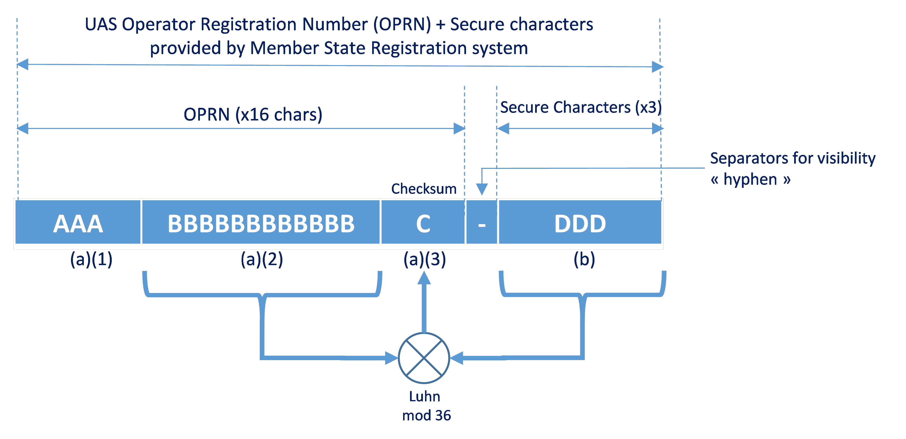

# Operator Registration Number

The UAS Operator Registration Number (OPRN) is a unique identifier assigned to each operator of a UAS.
It is assigned by the member state national aviation authority, and can be viewed as a kind of pilot license number.
See **EN 4709-002:2023, section 4.4** for more information.

