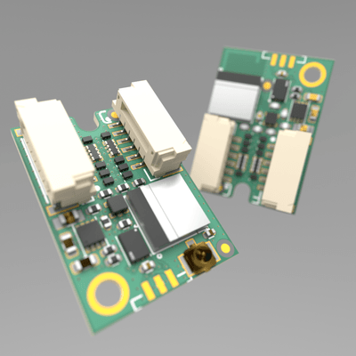
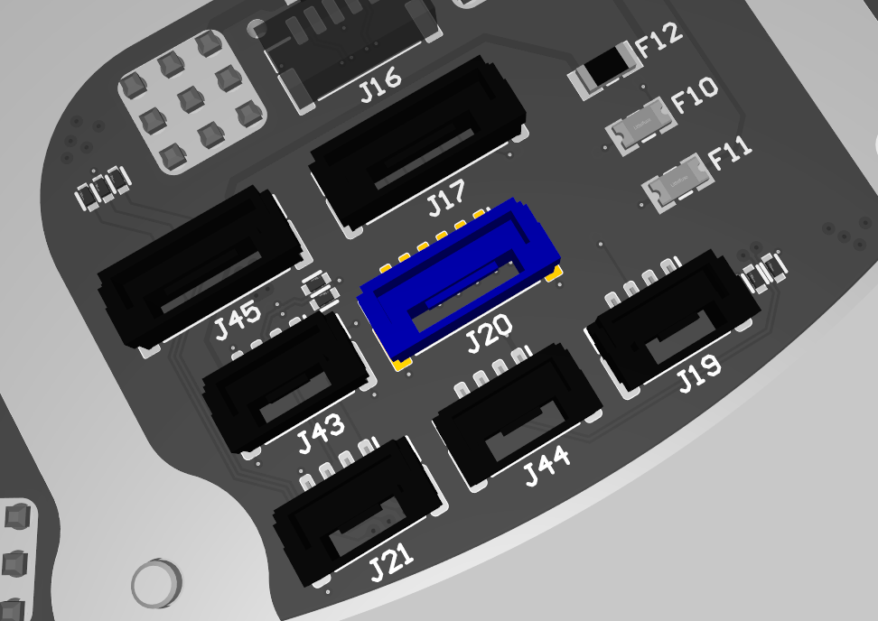
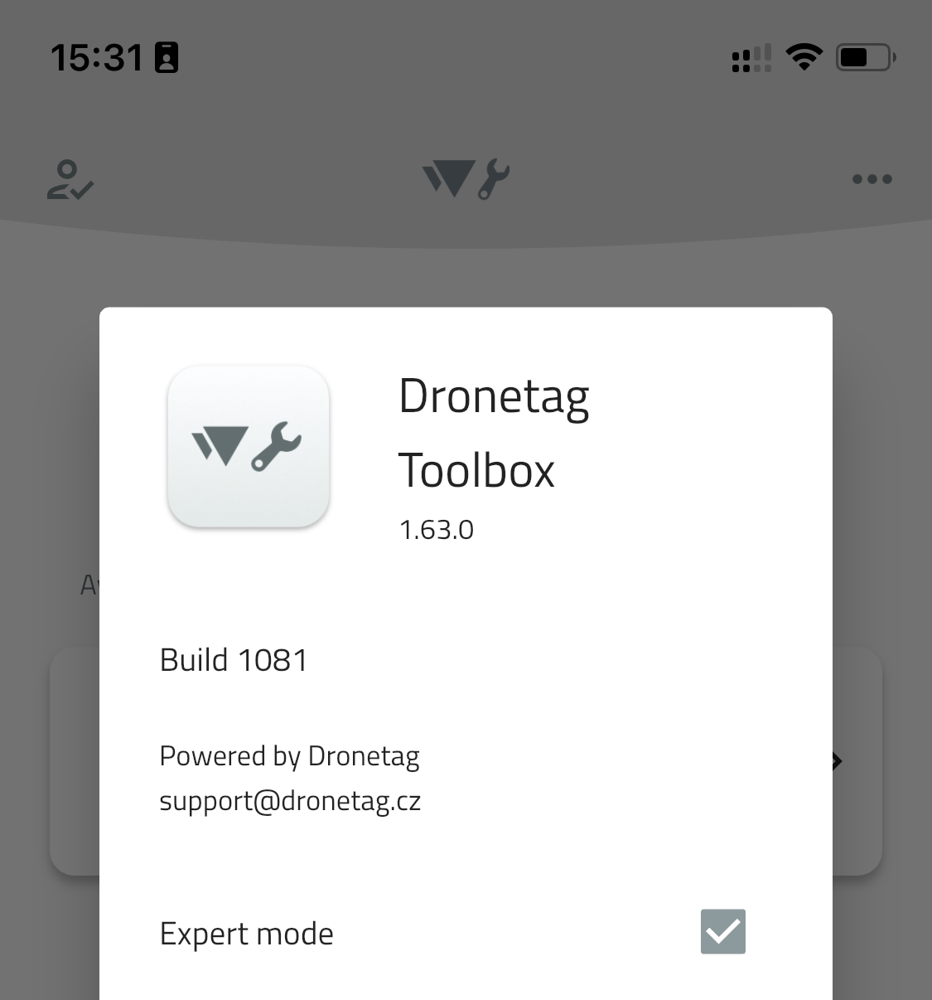

# DRI Module

{ align=right width=250 }

This section will guide you through the process of preparing a [Dronetag DRI][dronetag-dri] module for use with the Dronetag Agent.

[dronetag-dri]: https://dronetag.com/products/dri/

## Prerequisites

Along with the DRI module to configure, you will need a way to power it.  
This can be:

- a [HIGHDRA Motherboard][highdra-motherboard]
- a Skynode with [Pixhawk Adapter Board][pixhawk-adapter-board]
- a power supply (3.3 - 17 V) with GH6 connector

You will also need an iOS or Android device to configure the DRI module.

[pixhawk-adapter-board]: https://docs.auterion.com/hardware-integration/skynode/peripherals/adapter-boards
[highdra-motherboard]: https://starcopter.365.altium.com/designs/Manufacturing-Portal-8E6B5FC2-9B71-4BE3-BA49-3EF18DDFBC37?projectSourceGuid=76877CFA-931F-420B-BA06-544F94C40255&variant=Prototype#design
[dronetag-dri-help]: https://help.dronetag.com/dronetag-dri

## Wiring

The DRI module comes with a connector cable that can be used to power it.
The power supply should be connected to the DRI module's flight controller port, labelled **C**.
Refer to the [Wiring Diagram][dronetag-dri-wiring] for more information.

[dronetag-dri-wiring]: https://help.dronetag.com/dronetag-dri/integration#wiring-diagrams

### Motherboard

When powering the DRI module from a motherboard, connect it to the motherboard's **J20** connector.
It is located on the bottom side of the board, 7 o'clock position.

### Pixhawk Adapter Board

When powering the DRI module from a Skynode with a [Pixhawk Adapter Board][pixhawk-adapter-board],
connect it to the **TELEM1** (**J12**) connector.

### Power Supply

When powering the DRI module from a power supply, use whatever you have on hand.
The voltage should be between 3.3 V and 17 V, though I personally would recommend 5 V.

Polarity is like usual in the Pixhawk ecosystem:

| Pin | Name |
| --- | ---- |
| 1   | VCC  |
| 6   | GND  |

## Dronetag Toolbox

To configure the DRI module, you will need the Dronetag Toolbox app.  
Install it from the [:simple-appstore: App Store][dtt-app-store] or [:simple-googleplay: Google Play][dtt-google-play],
depending on your device.

Inside the Dronetag Toolbox app, press the three dots in the top right corner and select **About**.
In the dialog that appears, **press and hold** the logo for two seconds -- advanced settings will appear.
Select the checkbox for **Expert mode** and close the dialog.

{ width=300 }

[dtt-app-store]: https://apps.apple.com/us/app/dronetag-toolbox/id6443763841?platform=iphone
[dtt-google-play]: https://play.google.com/store/apps/details?id=cz.dronetag.toolbox

### Configuration

In the Dronetag Toolbox app, select the Dronetag DRI module to configure it.
Select the **Configuration** menu, and make sure the configuration is as follows:

| Parameter                   | Value       |
| --------------------------- | ----------- |
| Enable MAVlink flight start | enabled     |
| Enable Direct Remote ID     | enabled     |
| Static data frequency       | 2 Hz        |
| Dynamic data frequency      | 2 Hz        |
| GNSS input                  | MAVLink     |
| Pressure data input         | MAVLink     |
| Request Messages            | enabled     |
| MAVLink Integration Type    | OpenDroneID |
| Controller Port Baud Rate   | 115200      |
| Forward Port Baud Rate      | 115200      |

If you had to change any of these settings, press **Save** to apply the changes.

### Advanced Configuration

Go back to the device configuration screen and select the **Advanced Configuration** menu.

Expand the **mavlink** section and set the **mavlink/system** parameter to **2**.
Save this change by tapping the three dots in the top right corner and selecting **Save**.

## Next Steps

The DRI module is now configured.
After rebooting it once (power cycle), it should be ready to use with the Dronetag Agent.

!!! tip
    You should make a note of the DRI module's serial number, visible in the Dronetag Toolbox app.
    This will likely be needed later for production documentation purposes.

Continue to configuring the [Skynode](skynode.md) or installing the [Dronetag Agent](dronetag-agent.md).
