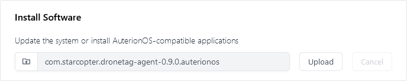
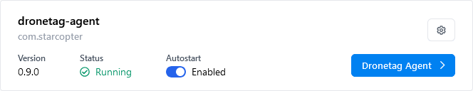
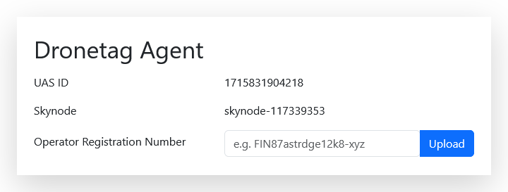

# Dronetag Agent

With both the DRI module and the Skynode configured, all that's left is to install the Dronetag Agent application.

For this you'll need:

- the [prepared](skynode.md) Skynode with a way to power it
- a way to connect to the Skynode (WiFi or USB-C)
- access to the [:simple-github: starcopter/dronetag-agent][dronetag-agent-repo] repository
- a laptop

## Download

The Dronetag Agent application is released with a GitHub Action workflow.
The latest release (`.auterionos` file) can be downloaded from the [Releases Page][dronetag-agent-releases].

## Install

Open the AuterionOS web interface in your browser ([10.41.0.1](http://10.41.0.1/) for WiFi, [10.41.1.1](http://10.41.1.1/) for USB-C).
In the **Install Software** section, select the `.auterionos` file you downloaded and click **Upload**.

!!! note

    If AuterionOS is asking for a password, try `starcopter` or `mountain`.

Wait for the installation to complete, then click on the **Apps** tab in the left sidebar.
You should see the Dronetag Agent in the list of installed user applications.

## Verify

Click the blue **Dronetag Agent >** button to open the application user interface.
If you see the following, the Dronetag Agent is working correctly:

[dronetag-agent-releases]: https://github.com/starcopter/dronetag-agent/releases/latest
[dronetag-agent-repo]: https://github.com/starcopter/dronetag-agent
