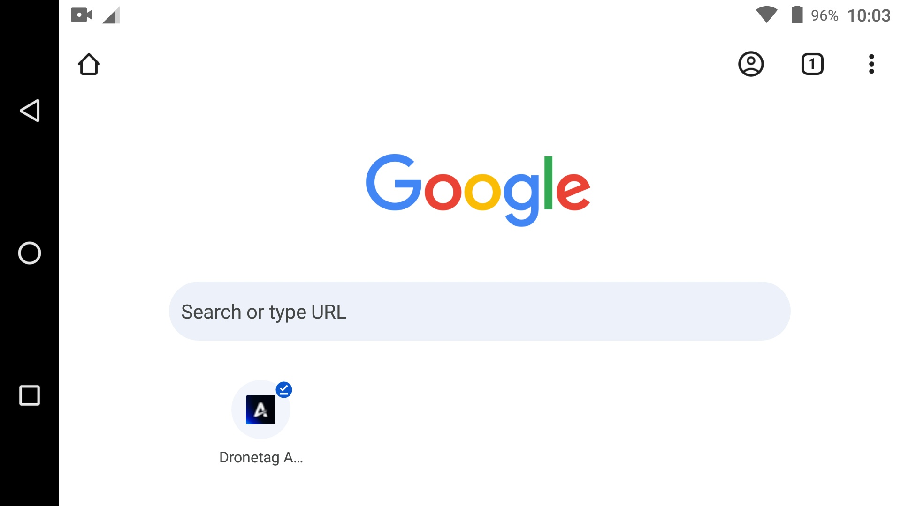

# Herelink

This will be quick.

## Bookmark

Open the Chrome browser on the Herelink and create a bookmark for the following address:

[http://192.168.144.20/apps/com.starcopter.dronetag-agent/](http://192.168.144.20/apps/com.starcopter.dronetag-agent/)

The bookmark will appear as an icon on the Chrome home screen under the search bar.
Remove all _other_ bookmarks (Facebook, Amazon, Kleinanzeigen, ...) by long-pressing each icon and selecting "Remove".

Disable the "Discover" section below by tapping on the gear symbol and selecting "Turn off".
The Chrome browser's home page now should look like this:

## Shortcut

Add a Chrome shortcut to the Herelink's home screen.
