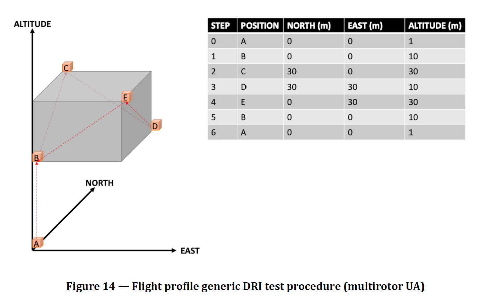

# EN 4709-002:2023

Summary of requirements from EN 4709-002:2023.

## 4 General Design Requirements

### 4.2 Mandatory information

The direct remote ID system shall broadcast locally the mandatory information listed below:

- Identification information:
    - the UAS operator registration number,
    - the unique serial number of the UA (or exclusively the add-on);
- Geolocation information:
    - the time stamp, the geographical position of the UA and its height above the ground or its takeoff point,
    - the route course measured clockwise from true north and ground speed of the UA,
    - the geographical position of the remote pilot, or if not available, the geographical position of the take-off point;
- UA status information:
    - the UAS emergency status for Class C1, C2, C3.

### 4.3 Security of the DRI system

General security requirement:

- the direct remote identification system shall reduce the ability of tampering with the functionality
  of the direct remote identification system.

!!! note

    The direct remote identification system is the on-board feature in the UA/add-on that is formatting
    and transmitting over the air the DRI information to a compatible receiver mobile device.

Specific security requirements:

- the UA and the add-on come with a unique serial number; this number is loaded at factory level and
  shall not be modified anymore afterwards. The protection of the unique serial number of the
  UA/Add-on shall be done by design. The serial number shall be stored in a secure memory area;

- the design of the DRI shall not allow the user to modify the Geolocation information part of the DRI
  message, as defined in 4.2 above.

The conformity to those requirements shall be proven per the OEM’s design documentation.

### 4.5 Performance requirements

This document defines several performance requirements:

- radio transmission performance: as radio-transmitting equipment, a DRI system shall comply with
  relevant standards on radio-transmitting equipment: ETSI EN 301 893 for Wi-Fi 5GHz and
  ETSI EN 300 328 V2.1.1 for Bluetooth and Wi-Fi 2,4 GHz (see Clause 2). These standards define
  only maximum transmit power values. To guarantee minimum performance of a DRI system, the
  DRI equipment shall comply with the minimum output power values defined in 5.4 and emission
  directivity requirements defined in 5.5;

- data transmission and update rates: to allow proper identification and tracking of UA by observers,
  the remote identification information shall be broadcasted periodically as defined in 5.6;

- direct remote identification information shall be received by existing mobile receiver devices (such
  as a smartphone, tablet, laptop, or any kind of mobile device).

### 4.6 Working time

The information broadcasted by the DRI system shall be transmitted during the whole duration of the
flight (i.e. when the drone is airborne).

The broadcasted information can optionally also be transmitted when the drone is on the ground
(i.e. from switch-on to switch-off).

## 5 Requirements for direct remote identification function

### 5.1 Data dictionary

Long section of tables with data types. Should be matched to MAVLink messages.

### 5.2 DRI messages

As above.

### 5.3 Broadcast transport protocols

Handled by the Dronetag DRI module. We'll include a reference, but don't need to repeat the content.

- 5.3.2 Bluetooth legacy advertising transport mechanism (4.x compatible)
- 5.3.3 Bluetooth long range advertising mechanism (5.x compatible)
- 5.3.4 Wi-Fi NAN transport method
- 5.3.5 Wi-Fi beacon transport method

!!! question "Transport Protocols"

    Ask Dronetag which transport protocols they use.

### 5.5 Emission directivity

To allow its detection in any direction within the broadcasting range, the DRI broadcasted signal should
be emitted as omni-directionally as possible considering the drone and antenna(s) design limitations.

The conformity to this requirement shall be proven per the OEM’s antenna design documentation.

### 5.6 Update and transmission rates

For all broadcast transport protocols, the transmission rate shall be as follows:

- dynamic messages (as indicated in the block message section) shall be sent at least every one second;
- static messages (as indicated in the block message section) shall be sent at least every three seconds;
- maximum data age: the maximum potential time elapsed since the time of applicability of the
  dynamic fields in the location/vector message shall be no older than one second;
- additionally, for Wi-Fi beacon transport method variant 3.a (5.3.5-variant 3.a), independently from
  the dynamic or static messages update rates, the message broadcast interval shall be ≤ 200 TU.

Should channel saturation block or interfere with transmission (as may occur due to “listen before talk”
interference handling technique), the system shall make a “best effort” to transmit when the saturation
level allows.

The conformity to this requirement shall be proven by testing as described in 6.3.

## 6 Verification requirements and test methods

### 6.2 DRI generic test procedure

The generic test procedure intends to describe the setup of the test environment and conditions, and all
the steps to follow, to check the compliancy of the UA or add-on DRI function with the Delegated
Regulation (EU) 2019/945 and Implementing Regulation (EU) 2019/947.

#### 6.2.2 Upload UAS operator registration number test procedure

Turn on the UAS/add-on, and from the tool provided by the UAS/add-on manufacturer:

##### Step 1

Fill a successive set of invalid UAS operator registration numbers, combining:

- several (at least five) examples of wrong structure (incorrect country code, invalid or misplaced
  characters) and right checksum (computed with the method described in 4.4);
- several (at least five) cases of right structure (correct country code, valid alphanumeric string) and
  wrong checksum, for instance: FIN87astrdge12k1-xyz.

!!! info "Pass Criteria"

    The system doesn’t accept any invalid number and warns the user with an error message.

##### Step 2

Check that the system requires to re-enter the full string containing the UAS operator registration
number and fill several (at least five) examples of valid UAS operator registration numbers, for
instance: FIN87astrdge12k8-xyz.

!!! info "Pass Criteria"

    No error message displayed; each valid UAS operator registration number is uploaded in the UA/addon.

!!! question

    What does _requiring to re-enter the full string_ mean? Where does this requirement come from?

#### 6.2.3 UAS DRI data field transmission testing procedure

!!! note

    This test shall be repeated (step 0 to step 4) for each supported transmission protocol, as
    specified in the manufacturer’s documentation.

##### Step 0: Serial number, UA class, UAS operator registration number

Turn on the UAS and wait for few seconds.

From the tool provided by the UAS/add-on manufacturer: fill an **invalid** UAS operator registration
number, for instance: FIN87astrdge12k1-xyz.

!!! info "Pass Criteria"

    UA serial number, UA class, are displayed on the receiver mobile device.
    The UAS operator registration number is not displayed on the receiver mobile device.

From the tool provided by the UAS/add-on manufacturer: fill a **valid** UAS operator registration number,
for instance: FIN87astrdge12k8-xyz.

!!! info "Pass Criteria"

    UA (or add-on) serial number, UA class, UAS operator registration number are displayed on the receiver
    mobile device.

##### Step 1: Other DRI Data fields

Have the UA flying in a fixed position (hovering/loitering) at a height above the surface of 10 m.

!!! info "Pass Criteria"

    Verify on the DRI receiver mobile device software that every mandatory (M) remote ID information
    (5.2) are correctly displaying the current UA/add-on flight status. e.g.:

    - correct operational status: “Airborne”;
    - correct timestamp, position and height, ground speed, the route course information;
    - correct remote pilot or take-off position information.

##### Step 2

Start flying the test procedure in accordance to Figure 14, from point B and then back to point B,
hovering minimum 5 seconds on every position.

!!! info "Pass Criteria"

    Verify on the DRI receiver mobile device software, if the received DRI information on all mandatory
    fields is correctly displaying the current UA flight status e.g.:

    - correct operational status: “airborne”;
    - correct timestamp, position and height, ground speed, the route course information;
    - correct remote pilot or take-off position information.

##### Step 3: Check remote pilot position or take-off position

Remote pilot is changing the position and moving 30 m into direction “West” and then moving back to point A.

!!! info "Pass Criteria"

    Verify if new position of remote pilot is correctly displayed on the receiver app. If no pilot position is
    available, verify if UA take-off point is correctly displayed on the receiver app.

##### Step 4: Check Emergency Status

Multiple different things can malfunction in an UAS. The severity of each specific failure depends on the
specific type of UAS and its capabilities. For some UAS, the loss of battery power is critical, for some the
loss of the C2 link or the loss of the location/GNSS signal etc.

For UAS belonging to Class C1, C2 or C3, the manufacturer of the UAS shall identify the types of failures
that can lead to a partial or full loss of a controlled flight trajectory and set the emergency status flag in
these situations. For each of the identified emergency scenarios, the manufacturer shall provide a way
to trigger or simulate the emergency. In this test step, activate each of the emergency scenarios one at a
time.

!!! info "Pass Criteria"

    Verify on the DRI receiver mobile device software, that the operational status of the UA changes to
    “Emergency” in each of the emergency scenarios as defined by the manufacturer.

### 6.3 Update and transmission rates test procedure

#### 6.3.1 General test setup

The test requires a computer (or laptop) with packet capturing software installed and a wireless
network card with sniffer function as a receiver which used to capture all the underlying raw data
transmitted by the UA or add-on. Either Wireshark or OmniPeek is commonly used to capture data
packets as popular software. The test should be carried out in a radio shielded room to avoid the
influence of wireless interference on the accuracy of the test results. Testing via direct cable connection
may also be considered.

!!! note

    Likely not relevant for starcopter. This is the responsibility of the DRI module manufacturer.

### 6.4 Remote ID compatibility with mobile device

??? tip "Annex C: Guidelines for mobile device selection"

    The purpose of this annex is to provide guidelines for gathering a set of mobile devices suitable for the
    execution of the test procedure described in 6.4.

    As described in 4.1 an interested person equipped with a receiver mobile device and with specific RID
    display software installed should be able to receive and display the information contained in remote ID
    broadcasted by an UA.

    The compatibility test procedure objective is to verify that the implementation of the transmission
    protocol is compatible with such mobile devices (smartphone or tablet). To be conclusive, this test
    needs to be performed with several receiver devices of different vendors, types and generation. Due to
    the short lifetime of such mobile devices, it is not practical in this document to be explicit on which set
    of devices should be used.

    Therefore, the organization in charge of performing the test should provide evidence, based on an
    independent market survey, that the set of mobile devices (smartphone and tablet) models selected
    represents at least a 60 % share of the European market of all recent (1-2 years old) and legacy (3-4
    years old) devices supporting at least one of the transmission protocols referenced in this standard. The
    set should include a minimum of 5 models from 2 vendors and include at least one tablet.

#### 6.4.1 General test setup

Remote ID transmitter shall be tested with a set of appropriate different mobile device receivers
compatible with the transmission protocol used and configured with a functional software application.
Manufacturers can give indications for selecting suitable receivers and optimized settings.

For representativeness, run the test with a set of mobile device receivers featuring the following
different properties:

- commonly available brand/models, widely used;
- running commonly available operating systems;
- supporting the transmission protocols implemented in the remote ID system;
- equipped with a RID display software;
- representative of several (at least two) mobile devices generations: recent (1-2 years old), legacy (3-4 years old).

#### 6.4.2 Measurement procedure

1. Set the DRI to power on, and to periodically broadcast data (at least serial number).
2. Start the DRI display software on each mobile device.
3. Configure the DRI as per the manufacturer’s documentation to successively transmit using the implemented transmission protocols.

!!! info "Pass Criteria"

    For each transmission protocol, check that correct information: UA (or add-on) serial number, is
    displayed on each compatible receiver mobile device.

    The standard does not specify receiver performance. The receiver shall be considered as a test
    equipment used to receive and decode the Remote ID message and the conducted test assumes to select
    reliable receivers.
