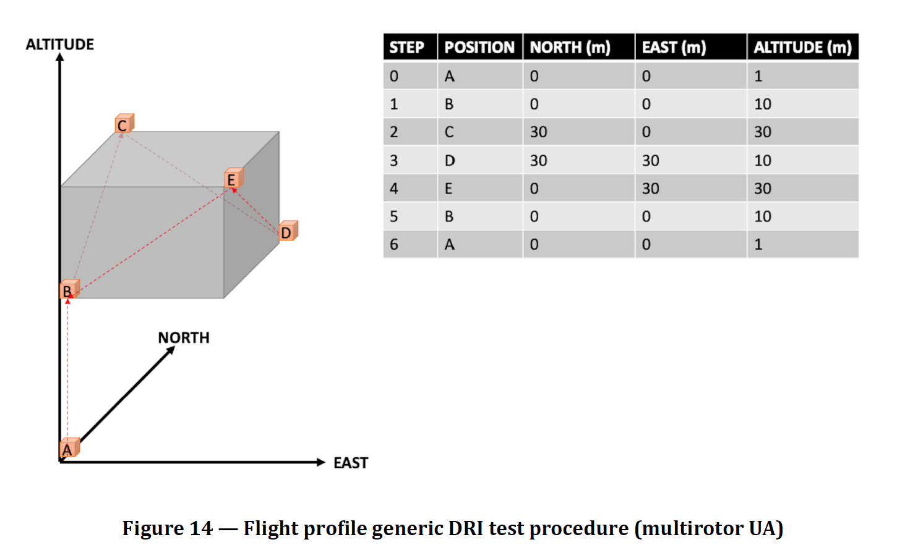

# Test Methods

Requirements from chapter 6 from EN 4709-002:2023.

## 6.2 DRI Generic Test Procedure

The generic test procedure intends to describe the setup of the test environment and conditions, and all
the steps to follow, to check the compliancy of the UA or add-on DRI function with the Delegated
Regulation (EU) 2019/945 and Implementing Regulation (EU) 2019/947.

### 6.2.2 Upload UAS Operator Registration Number Test Procedure

Turn on the UAS/add-on, and from [the tool provided by the UAS manufacturer](../../manual/index.md#uploading-the-oprn):

#### Step 1

Fill a successive set of invalid UAS operator registration numbers, combining:

- several (at least five) examples of wrong structure (incorrect country code, invalid or misplaced
  characters) and right checksum (computed with the method described in 4.4);
- several (at least five) cases of right structure (correct country code, valid alphanumeric string) and
  wrong checksum, for instance: FIN87astrdge12k1-xyz.

!!! info "Pass Criteria"

    The system doesn't accept any invalid number and warns the user with an error message.

#### Step 2

Check that the system requires to re-enter the full string containing the UAS operator registration
number and fill several (at least five) examples of valid UAS operator registration numbers, for
instance: FIN87astrdge12k8-xyz.

!!! info "Pass Criteria"

    No error message displayed; each valid UAS operator registration number is uploaded in the UA/addon.

### 6.2.3 UAS DRI Data Field Transmission Testing Procedure

This test shall be repeated (step 0 to step 4) for each supported transmission protocol, as
specified in the manufacturer's documentation.

!!! note

    We support Bluetooth 4.0 Legacy and Bluetooth 5.0 Long Range.

#### Step 0

Turn on the UAS and wait for few seconds.

From the tool provided by the UAS manufacturer:
fill an **invalid** UAS operator registration number, for instance: FIN87astrdge12k1-xyz.

!!! info "Pass Criteria"

    UA serial number, UA class, are displayed on the receiver mobile device.  
    The UAS operator registration number is _not_ displayed on the receiver mobile device.

From the tool provided by the UAS manufacturer:
fill a **valid** UAS operator registration number, for instance: FIN87astrdge12k8-xyz.

!!! info "Pass Criteria"

    UA serial number, UA class, UAS operator registration number are displayed on the receiver mobile device.

#### Step 1

Have the UA flying in a fixed position (hovering/loitering) at a height above the surface of 10 m.

!!! info "Pass Criteria"

    Verify on the DRI receiver mobile device software that every mandatory (M) remote ID information
    (5.2) are correctly displaying the current UA flight status. e.g.:

    - correct operational status: "Airborne";
    - correct timestamp, position and height, ground speed, the route course information;
    - correct remote pilot or take-off position information.

#### Step 2

Start flying the test procedure in accordance to Figure 14, from point B and then back to point B,
hovering minimum 5 seconds on every position.

!!! info "Pass Criteria"

    Verify on the DRI receiver mobile device software, if the received DRI information on all mandatory
    fields is correctly displaying the current UA flight status e.g.:

    - correct operational status: "airborne";
    - correct timestamp, position and height, ground speed, the route course information;
    - correct remote pilot or take-off position information.

#### Step 3

Remote pilot is changing the position and moving 30 m into direction "West" and then moving back to point A.

!!! info "Pass Criteria"

    Verify if new position of remote pilot is correctly displayed on the receiver app.
    If no pilot position is available, verify if UA take-off point is correctly displayed on the receiver app.

!!! note

    The starcopter HIGHDRA does not provide a live (or fixed) pilot position.
    Only the take-off position is available.

#### Step 4

Multiple different things can malfunction in an UAS. The severity of each specific failure depends on the
specific type of UAS and its capabilities. For some UAS, the loss of battery power is critical, for some the
loss of the C2 link or the loss of the location/GNSS signal etc.

For UAS belonging to Class C1, C2 or C3, the manufacturer of the UAS shall identify the types of failures
that can lead to a partial or full loss of a controlled flight trajectory and set the emergency status flag in
these situations. For each of the identified emergency scenarios, the manufacturer shall provide a way
to trigger or simulate the emergency. In this test step, activate each of the emergency scenarios one at a
time.

!!! info "Pass Criteria"

    Verify on the DRI receiver mobile device software, that the operational status of the UA changes to
    "Emergency" in each of the emergency scenarios as defined by the manufacturer.

!!! note

    Please take a look at the [Operational Status](../operational-status/index.md) page for more information
    on emergency scenarios.

## 6.3 Update and Transmission Rates Test Procedure

### 6.3.1 General Test Setup

The test requires a computer (or laptop) with packet capturing software installed and a wireless
network card with sniffer function as a receiver which used to capture all the underlying raw data
transmitted by the UA or add-on. Either Wireshark or OmniPeek is commonly used to capture data
packets as popular software. The test should be carried out in a radio shielded room to avoid the
influence of wireless interference on the accuracy of the test results. Testing via direct cable connection
may also be considered.

!!! note

    Likely not relevant for starcopter. This is the responsibility of the DRI module manufacturer.

## 6.4 Remote ID Compatibility with Mobile Device

??? tip "Annex C: Guidelines for mobile device selection"

    The purpose of this annex is to provide guidelines for gathering a set of mobile devices suitable for the
    execution of the test procedure described in 6.4.

    As described in 4.1 an interested person equipped with a receiver mobile device and with specific RID
    display software installed should be able to receive and display the information contained in remote ID
    broadcasted by a UA.

    The compatibility test procedure objective is to verify that the implementation of the transmission
    protocol is compatible with such mobile devices (smartphone or tablet). To be conclusive, this test
    needs to be performed with several receiver devices of different vendors, types and generation. Due to
    the short lifetime of such mobile devices, it is not practical in this document to be explicit on which set
    of devices should be used.

    Therefore, the organization in charge of performing the test should provide evidence, based on an
    independent market survey, that the set of mobile devices (smartphone and tablet) models selected
    represents at least a 60 % share of the European market of all recent (1-2 years old) and legacy (3-4
    years old) devices supporting at least one of the transmission protocols referenced in this standard. The
    set should include a minimum of 5 models from 2 vendors and include at least one tablet.

### 6.4.1 General Test Setup

Remote ID transmitter shall be tested with a set of appropriate different mobile device receivers
compatible with the transmission protocol used and configured with a functional software application.
Manufacturers can give indications for selecting suitable receivers and optimized settings.

For representativeness, run the test with a set of mobile device receivers featuring the following
different properties:

- commonly available brand/models, widely used;
- running commonly available operating systems;
- supporting the transmission protocols implemented in the remote ID system;
- equipped with a RID display software;
- representative of several (at least two) mobile devices generations: recent (1-2 years old), legacy (3-4 years old).

### 6.4.2 Measurement Procedure

1. Set the DRI to power on, and to periodically broadcast data (at least serial number).
2. Start the DRI display software on each mobile device.
3. Configure the DRI as per the manufacturer's documentation to successively transmit using the implemented transmission protocols.

!!! info "Pass Criteria"

    For each transmission protocol, check that correct information: UA (or add-on) serial number, is
    displayed on each compatible receiver mobile device.

    The standard does not specify receiver performance. The receiver shall be considered as a test
    equipment used to receive and decode the Remote ID message and the conducted test assumes to select
    reliable receivers.
