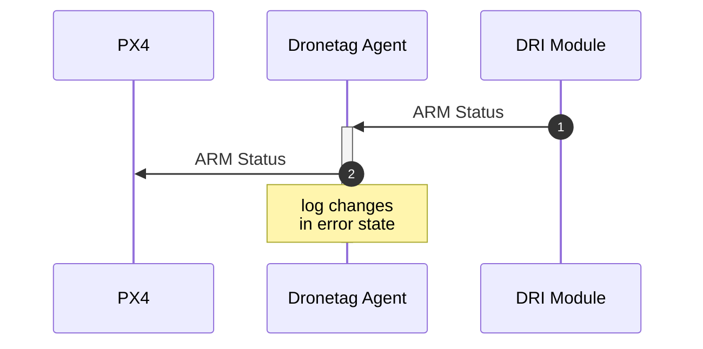

# ARM Status

ARM Status is a MAVLink-only message ([ODID_ARM_STATUS]), which is not part of the EN 4709-002 standard.
It is published by the DRI module 

[ODID_ARM_STATUS]: https://mavlink.io/en/messages/common.html#OPEN_DRONE_ID_ARM_STATUS

## Fields

| Name     | Description        |
| -------- | ------------------ |
| `status` | DRI status         |
| `error`  | Text error message |

### Status

The status field is a single bit, indicating if an error is present:

| Value | Description                                     |
| ----- | ----------------------------------------------- |
| 0     | Good to arm                                     |
| 1     | Generic failure, see `error` string for details |

### Error

The error string is a text message indicating the error that occurred.
Will be empty if no error is present (`status` is 0).

## Implementation

The arm status is forwarded from the DRI module to the FMU.
When the arm status changes, the Dronetag Agent will log the change.

The FMU will use this information to notify the operator if the UA is not ready to arm,
depending on the PX4 parameter [COM_ARM_ODID].

[COM_ARM_ODID]: https://docs.px4.io/main/en/advanced_config/parameter_reference.html#COM_ARM_ODID
