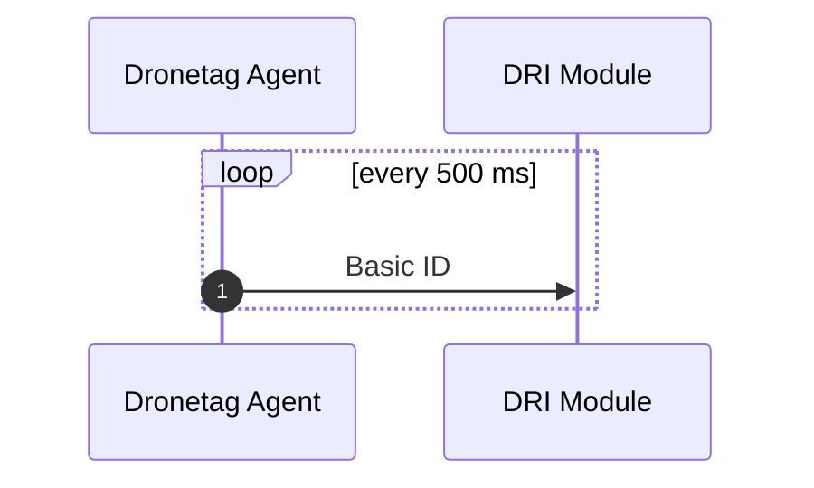

# Basic ID

The Basic ID message corresponds to the MAVLink [ODID_BASIC_ID] message.

[ODID_BASIC_ID]: https://mavlink.io/en/messages/common.html#OPEN_DRONE_ID_BASIC_ID

??? quote "5.2.3 Basic ID message"

    Basic ID Message has type: 0x0 value, static periodicity and is mandatory.

    The Basic ID message includes the ID type, UA type, and the unique ID. This unique ID shall contain by
    default the manufacturer serial number of the UA/add-on. But the basic ID message can be used
    alternatively to broadcast other UAS IDs.

    Once the UA is provisioned, the UAS ID shall be one of the following:
   
    1. manufacturer serial number;
    2. a Civil Aviation Authority (CAA) issued registration ID for the UA formatted as described in the Data Dictionary;
    3. a UTM assigned ID if operating within a UTM system (128-bit UUID) binary encoded, network byte order;
    4. specific session ID according to an externally defined registered scheme indicated by a unique
       session ID scheme ID type. The first byte of the specific session ID shall be the specific session ID
       type (1-255) where 0 is reserved, 1-224 is the registered type, and 225-255 are available for
       private experimental use only. If using this method, the specific session ID sype shall be registered
       through an external registration entity. Using the experimental range is not considered "compliant"
       to this document but may be used for testing and experimentation.
   
    Two different Basic ID Messages shall be successively transmitted in case both CAA registration ID and
    manufacturer serial number are to be transmitted.

## Fields

| Name    |  C3   | Description               |
| ------- | :---: | ------------------------- |
| ID Type | **M** | Type of UAS ID, must be 1 |
| UA Type | **O** | Type of the UA            |
| UAS ID  | **M** | UAS serial number         |

### ID Type (M)

Fixed to 1, indicating that the [UAS ID](#uas-id-m) is a serial number in ANSI/CTA-2063-A format.
This is marked mandatory in EN 4709-002:2023.

### UA Type (O)

Statically configured by starcopter during production, cannot be changed by the user.
Will always be 2 (Multirotor) for the HIGHDRA.

### UAS ID (M)

UAS serial number in ANSI/CTA-2063-A format, starting with `1715`, starcopter's manufacturer code.
Configured by starcopter during production, cannot be changed by the user.

## Implementation

The Basic ID message is periodically created by the Dronetag Agent and sent to the DRI module.

