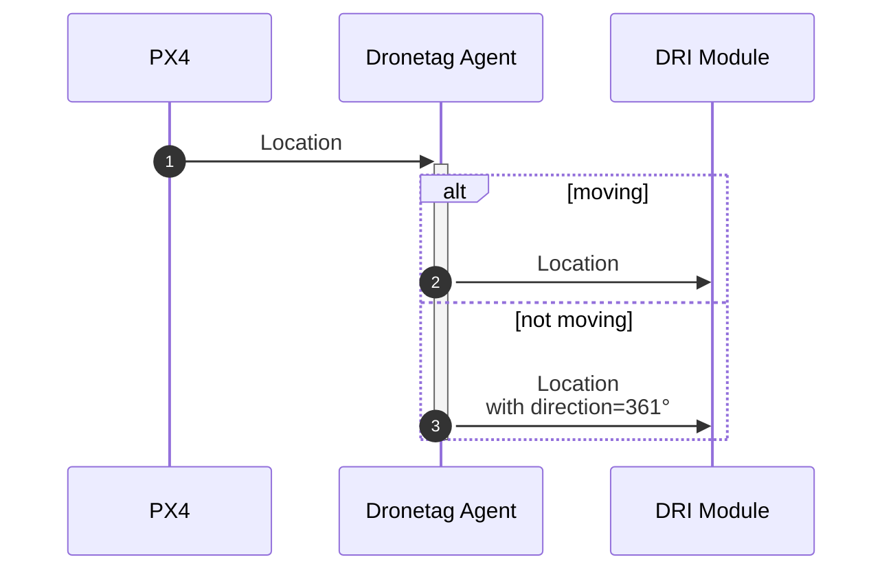

# Location

The Location message corresponds to the MAVLink [ODID_LOCATION] message.

[ODID_LOCATION]: https://mavlink.io/en/messages/common.html#OPEN_DRONE_ID_LOCATION

??? quote "5.2.4 Location/vector message"

    Location/vector message has type: 0x1 value, dynamic periodicity and is mandatory.

    The location/vector message is used to transmit the UA mandatory information such as “track
    direction”, “speed over ground”, “latitude”, “longitude”, “height”, and the “timestamp”. The data fields
    included in the DRI message shall comply with the requirements defined in Table 3. Several fields are
    encoded to allow a better packing of the data and provide more precise values. When indicated, the
    transmitted data shall be encoded according to encoding Table 9.

    Any field requiring a flag bit to be set shall be set according to the encoding table as well.

Other than the EN 4709-002 location/vector message, the [ODID_LOCATION] message is slightly more verbose:
The message actually transmitted by the DRI module includes more encoding to pack data more densely.

The MAVLink message thus includes more information (higher resolution) than the EN 4709-002 message.

## Fields

| Name                  |  C3   | Description                                            |
| --------------------- | :---: | ------------------------------------------------------ |
| `status`              | **M** | Operational Status                                     |
| `direction`           | **M** | Course over Ground                                     |
| `speed_horizontal`    | **M** | Ground Speed                                           |
| `speed_vertical`      | **O** | Vertical Speed                                         |
| `latitude`            | **M** | Latitude                                               |
| `longitude`           | **M** | Longitude                                              |
| `altitude_barometric` | **O** | Altitude calculated from barometric pressure           |
| `altitude_geodetic`   | **O** | Altitude as defined by WGS84                           |
| `height_reference`    | **M** | Reference point for next field                         |
| `height`              | **M** | Height above reference point                           |
| `horizontal_accuracy` | **O** | Accuracy of the horizontal position                    |
| `vertical_accuracy`   | **O** | Accuracy of the vertical position                      |
| `barometer_accuracy`  | **O** | Accuracy of the barometric altitude                    |
| `speed_accuracy`      | **O** | Accuracy of the horizontal and vertical speed          |
| `timestamp`           | **M** | Seconds after the full hour with reference to UTC time |
| `timestamp_accuracy`  | **O** | Accuracy of the timestamps                             |

### Status (M)

Operational status of the UA.
Possible values are:

| Value | Meaning    | Impementation                                    |
| ----- | ---------- | ------------------------------------------------ |
| 0     | Undeclared | _not used by PX4_                                |
| 1     | Grounded   | Normal operation on the ground                   |
| 2     | Airborne   | Armed, possibly flying                           |
| 3     | Emergency  | Emergency (C2 Link Loss, Low Battery, GNSS Loss) |

!!! warning

    Add link to emergency status description.

### Direction (M)

!!! quote "EN 4709-002 Track direction"

    The direction of flight taken by the UA with reference to “True North-based” ground track angle.
    It is measured in clockwise degrees and has a minimum resolution of 1 degree.
    If the aircraft is not moving horizontally, use the “Unknown” value.
    Special values as invalid, no value, or unknown are coded with 361 deg.

PX4 always publishes this field, even when the UA is not (significantly) moving.
Due to GPS noise, the value will thus randomly change when the UA is stationary.

To mitigate this, the Dronetag Agent patches this value before forwarding the message to the DRI module.
The reported [speed](#speed-horizontal-m) is compared to a threshold, depending on the [accuracy](#accuracy-fields-o) of the
speed measurement. If the speed is below the threshold, the direction is set to "Unknown" (361 deg).

| Speed Accuracy | Speed Threshold |
| -------------: | --------------: |
|      < 0.3 m/s |        0.15 m/s |
|        < 1 m/s |         0.5 m/s |
|        < 3 m/s |         1.5 m/s |
|       < 10 m/s |           5 m/s |
|        unknown |          10 m/s |

### Speed Horizontal (M)

Ground speed of flight.
Together with the [direction](#direction-m), this forms the vector of the UA's movement.

### Speed Vertical (O)

Vertical speed, up is positive.

### Latitude and Longitude (M)

Geodetic coordinates of the UA.
This is filled by PX4, using its best position estimate.

### Barometric and Geodetic Altitude (O)

Altitude calculated from barometric pressure and above WGS84 ellipsoid, respectively.
These two fields are optional.

### Height Reference (M)

Reference point for the [height](#height-m) field.
Values are:

| Value | Meaning                    |
| ----- | -------------------------- |
| 0     | Height above takeoff point |
| 1     | Height above ground level  |

This implementation will always indicate height above the takeoff location.

### Height (M)

Height above reference point, takeoff or ground level.

!!! info

    Refer to the [height reference](#height-reference-m) field for information on the reference point.
    This will never be global WGS84 altitude!

### Accuracy Fields (O)

The five optional fields `horizontal_accuracy`, `vertical_accuracy`, `barometer_accuracy`, `speed_accuracy` and `timestamp_accuracy`
are used to indicate the accuracy of position, speed and time estimates.

Refer to the [MAVLink documentation](https://mavlink.io/en/messages/common.html#OPEN_DRONE_ID_LOCATION)
for more information on the encoding values.

### Timestamp (M)

Partial timestamp of the message, seconds after the full hour with reference to UTC time.
This is published by PX4, using the system's GPS time.

## Implementation

The Location message is forwarded from the FMU to the DRI module.
The direction is patched if the UA is not moving (see [above](#direction-m)).

