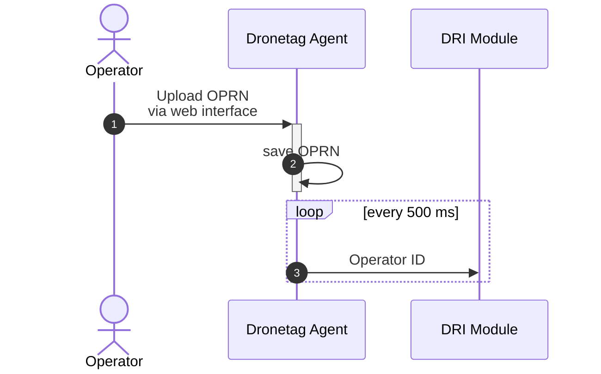

# Operator ID

The Operator ID message corresponds to the MAVLink [ODID_OPERATOR_ID] message.

[ODID_OPERATOR_ID]: https://mavlink.io/en/messages/common.html#OPEN_DRONE_ID_OPERATOR_ID

??? quote "5.2.7 Operator ID message"

    Operator ID message has type: 0x5 value, static periodicity and is mandatory.

    The operator ID message contains the operator ID (UAS operator registration number) information
    being released by the CAA; the relevant description is in the common Data Dictionary, and format
    explained in 4.4 "Upload of UAS operator registration number".

## Fields

| Name             |  C3   | Description                      |
| ---------------- | :---: | -------------------------------- |
| Operator ID Type | **M** | Type of Operator ID, must be 1   |
| Operator ID      | **M** | UAS operator registration number |

### Operator ID Type (M)

Type of Operator ID field.

| Value   | Meaning                        |
| ------- | ------------------------------ |
| 0       | Operator ID                    |
| 1-200   | Reserved                       |
| 201-255 | Available for experimental use |

Fixed to 0, indicating that the [Operator ID](#operator-id-m) is an Operator Registration Number (OPRN)
as specified in EN 4709-002:2023, Section 4.4.

### Operator ID (M)

ASCII-encoded UAS operator registration number.

This is uploaded by the operator as described in [Uploading the OPRN](../../manual/index.md#uploading-the-oprn),
and stored persistently by the Dronetag Agent until reset by the operator.

## Implementation

A [web interface](../../manual/index.md#accessing-the-web-ui) is provided for the operator to upload the OPRN.

The Dronetag Agent will publish the Operator ID message periodically, with the number uploaded by the operator.

In case no valid OPRN is available, an empty string is published.

