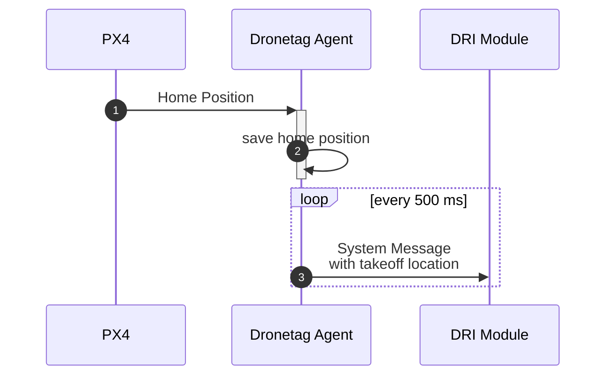

# System

The System message corresponds to the MAVLink [ODID_SYSTEM] message.

[ODID_SYSTEM]: https://mavlink.io/en/messages/common.html#OPEN_DRONE_ID_SYSTEM

??? quote "5.2.6 System message"

    System message has Type 0x4 value, static periodicity and it is mandatory.

    The system message contains the remote pilot location (Latitude and Longitude).

    Some other data can be transmitted optionally as general system information including information
    about the flight area.

    In case the GCS has a dynamic location source (e.g. GNSS), then the remote pilot location fields shall be
    the current location information of the GCS as acquired from the dynamic source.

    In case the GCS is not receiving any dynamic location data, then the aircraft's take-off location shall be
    assumed as the remote pilot location field. In this case, since this value generally does not vary as a UA
    location can vary, the minimum update frequency shall be the same as static messages.

    In case a group of aircraft is being represented, the number of aircraft, the radius of flight area centred
    on the location/vector message latitude/longitude and the group operations ceiling and floor can be
    expressed in this message using the Area fields.

    In case one or more UA are non-equipped, the area fields can be used to declare (via broadcast
    messages compliant with this section) a volume of operation by a device external to the UA (such as a
    ground station) centred on the location/vector message latitude/longitude.

    If the value for one or more fields is unknown, that field shall be filled as specified in the common Data
    Dictionary.

## Fields

| Name                     |  C3   | Description                                                          |
| ------------------------ | :---: | -------------------------------------------------------------------- |
| `operator_location_type` | **M** | Operator location type                                               |
| `classification_type`    | **M** | UA classification type                                               |
| `operator_latitude`      | **M** | Operator/Takeoff latitude                                            |
| `operator_longitude`     | **M** | Operator/Takeoff longitude                                           |
| `area_count`             | **O** | Number of aircraft in the area, group or formation (default 1)       |
| `area_radius`            | **O** | Radius of the cylindrical area of the group or formation (default 0) |
| `area_ceiling`           | **O** | Area Operations Ceiling relative to WGS84. If unknown: -1000 m       |
| `area_floor`             | **O** | Area Operations Floor relative to WGS84. If unknown: -1000 m         |
| `category_eu`            | **R** | UA operational category (OPEN, SPECIFIC, ...)                        |
| `class_eu`               | **R** | UA operational class (C3, C4, C5, ...)                               |
| `operator_altitude_geo`  | **O** | Geodetic altitude of the operator relative to WGS84                  |

### Operator Location Type (M)

Type of operator location: operator or takeoff location.

| Value | Meaning                            |
| ----- | ---------------------------------- |
| 0     | Take-Off Location                  |
| 1     | Operator Location (live GNSS)      |
| 2     | Operator Location (fixed position) |

!!! info

    For the starcopter HIGHDRA, this is always 0, "Takeoff Location".

### Operator Latitude and Longitude (M)

Informs about the remote pilot latitude/longitude position, or if not available, the take-off latitude/longitude position.
Special values as invalid, no value, or unknown are coded with 0 deg simultaneously for both latitude and longitude.

!!! info

    Refer to the [operator location type](#operator-location-type-m) field for more context on this field.

### Operator Altitude Geo (O)

Geodetic altitude of the operator (or takeoff location) relative to WGS84.
If unknown, this field is set to -1000 m.

### Classification Type (M)

This field specifies the type of data in the UA Category and UA Class fields.

| Value | Meaning    |
| ----- | ---------- |
| 0     | Undeclared |
| 1     | EU         |

When set to 0 "Undeclared", the UA Category and UA Class fields are to be ignored.

#### UA Category (R)

The category of UAS operation as defined in Implementing Regulation (EU) 2019/947 (OPEN, SPECIFIC, CERTIFIED).
See [MAVLink documentation](https://mavlink.io/en/messages/common.html#MAV_ODID_CATEGORY_EU) for more information.

#### UA Class (R)

The class of the UA as defined in the Delegated Regulation (EU) 2019/945 (C0 to C6).
See [MAVLink documentation](https://mavlink.io/en/messages/common.html#MAV_ODID_CLASS_EU) for more information.

### Swarm Operations Area (O)

The four fields `area_count`, `area_radius`, `area_ceiling` and `area_floor` are used to declare a volume of operation
when operating multiple UA in a swarm. Since the HIGHDRA is a single UA, these fields are not used.

## Implementation

PX4 does not publish the [ODID_SYSTEM] message, therefore it has to be created by the Dronetag Agent.
For this, the takeoff location and altitude are taken from the [HOME_POSITION] message, which is published by PX4.
The home position is the takeoff location of the UA, and automatically updated by PX4.

[HOME_POSITION]: https://mavlink.io/en/messages/common.html#HOME_POSITION

The remaining fields are hard-coded to the following values:

- `operator_location_type`: 0 (Takeoff Location)
- `classification_type`: 1 (EU)
- `category_eu`: 1 (Open)
- `class_eu`: 4 (C3)
- `area_count`: 1 (Single UA)
- `area_radius`: 0 (Single UA)
- `area_ceiling`: -1000 m (Not used)
- `area_floor`: -1000 m (Not used)
