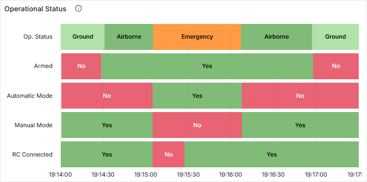

# Loss of C2 Link

When the C2 link (connection between drone and controller) is lost, the drone automatically enters a failsafe mode
and initiates a return to launch, in an attempt to re-establish the link. In this mode, the drone advertises an
**Emergency** status, as the pilot is not able to take control of the drone.

When the C2 link is regained (e.g. because the drone re-enters the range of the controller), the drone stays in the
Return to Launch mode (failsafe action) until the pilot takes over control, or the drone has landed.

As soon as the drone exits its failsafe action, the advertised operational status is reset. Depending on the case,
this is either **Airborne** (if the pilot has taken over control in-air), or **Grounded** (if the drone has landed).

## Test Setup

This was tested on a HIGHDRA without arms, normally powered by its flight batteries.

1. The drone was armed in Altitude mode from the Herelink controller, and a takeoff was simulated by lifting the drone up
   by hand and tilting it slightly forward.
2. The Herelink controller was then powered off, causing the C2 link to be lost. The drone automatically entered
   Return to Launch mode in an attempt to re-establish the link. _It obviously did not move, since no arms were attached._
4. The Herelink controller was then powered back on, and the C2 link reestablished. The drone registered the link as regained,
   but stayed in Return to Launch mode, since the pilot did not take over control yet.
5. The pilot took over control by switching (reverting) to Altitude mode. The return to launch was aborted.
6. A landing was simulated by setting the drone on the ground, keeping it level and lowering the throttle to 0.
   It automatically disarmed, as the FMU detected a landing.

## Results

The trace displayed below ([dashboard][grafana-mavlink-loss-of-c2]) shows the sequence of events described above.

* At 19:14:28, the drone was armed. Three seconds later, it took off (simulated), entering **Airborne** status.
* At 19:15:04, the Herelink controller was powered off, causing the C2 link to be lost.
  The drone automatically entered Return to Launch mode, and the operational status was set to **Emergency**.
* At 19:15:27, the Herelink controller was powered back on, and the C2 link was reestablished.
* At 19:16:07, the pilot took over control, which caused the drone to return to **Airborne** status.
* At 19:16:57, the drone landed (simulated), and the operational status returned to **Grounded**.

[grafana-mavlink-loss-of-c2]: https://grafana.starcopter.de/d/dedcyqkd0cphcc/dri-operational-status?orgId=1&from=1736878440000&to=1736878650000
