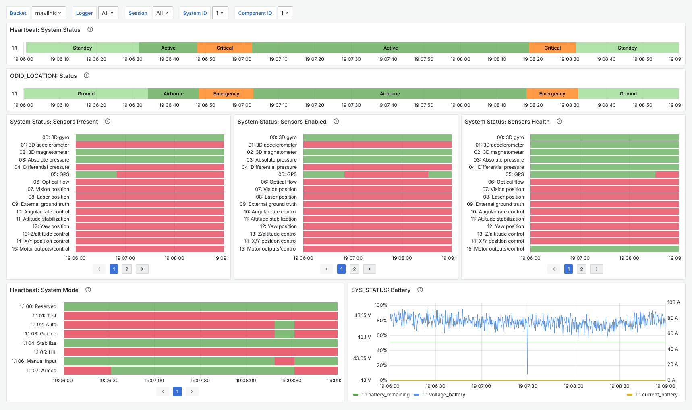
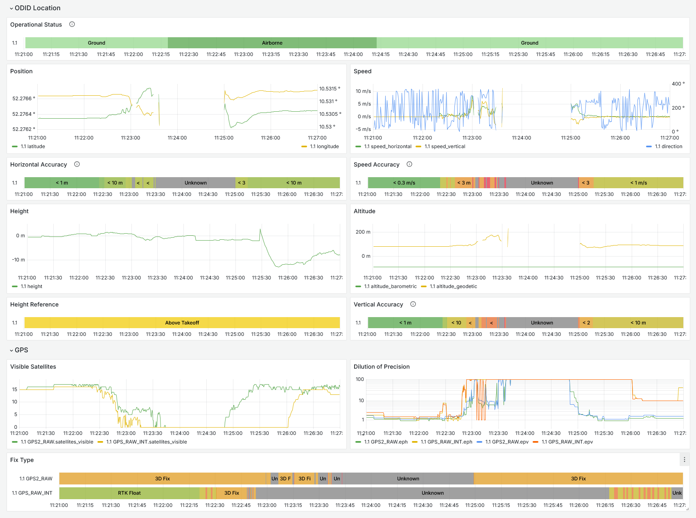

# Loss of GNSS :construction:

In case of GNSS deterioration (or even complete loss) in position control, PX4 will enter [Position Loss Failsafe][position-gps-loss-failsafe].
The threshold for this is set by the parameter [`COM_POS_FS_EPH`][COM_POS_FS_EPH], which defaults to 5 meters. When this failsafe action
is triggered, the copter will enter Altitude mode (with [`COM_POSCTL_NAVL`][COM_POSCTL_NAVL] set to 0) for the pilot to take over control.

The trace displayed below ([dashboard][grafana-mavlink-loss-of-gnss]) shows a deliberate GNSS loss: the copter was flying in Position mode,
and the GNSS signal was disturbed, falling below the configured error threshold at around 19:06:47. The copter correctly performed the
failsafe action by switching to Altitude mode, the status field was set to **Emergency**. The pilot was able to reset the failsafe action
by manually switching to (or confirming the automatic switch to) Altitude mode at 19:07:02: The drone remained in Altitude mode, but the
emergency status flag was cleared, reverting to **Airborne**.
At 19:08:18 an automatic landing was triggered via the Herelink controller (top left corner, [Land Mode][px4-flight-mode-land]).
Since GNSS was still not available, the copter descended to the ground without position control, the status flag was set to **Emergency**.
The successful landing at 19:08:32 cleared the emergency status flag, and the copter returned to **Ground** status.

[position-gps-loss-failsafe]: https://docs.px4.io/v1.14/en/config/safety.html#position-gps-loss-failsafe
[COM_POS_FS_EPH]: https://docs.px4.io/v1.14/en/advanced_config/parameter_reference.html#COM_POS_FS_EPH
[COM_POSCTL_NAVL]: https://docs.px4.io/v1.14/en/advanced_config/parameter_reference.html#COM_POSCTL_NAVL
[px4-flight-mode-land]: https://docs.px4.io/v1.14/en/flight_modes_mc/land.html
[grafana-mavlink-loss-of-gnss]: https://grafana.starcopter.de/d/ae9v33evpjjswa/mavlink-snippets?orgId=1&from=1736877960000&to=1736878140000&var-datasource=Mig5CVbnk&var-bucket=mavlink&var-logger=All&var-session=All&var-system_id=1&var-component_id=1

In a flight mode _not_ requiring a valid position estimate (like Altitude mode), the GNSS loss failsafe action is not triggered.
The trace displayed below ([dashboard][grafana-mavlink-complete-gnss-loss]) shows a deliberate GNSS loss: the copter was flying in Altitude mode, and even with a complete loss of the GNSS signal, the status remained **Airborne**.

[grafana-mavlink-complete-gnss-loss]: https://grafana.starcopter.de/d/ae9v33evpjjswa/mavlink-snippets?orgId=1&from=1736936460000&to=1736936820000&var-datasource=Mig5CVbnk&var-bucket=mavlink&var-logger=All&var-session=All&var-system_id=1&var-component_id=1
