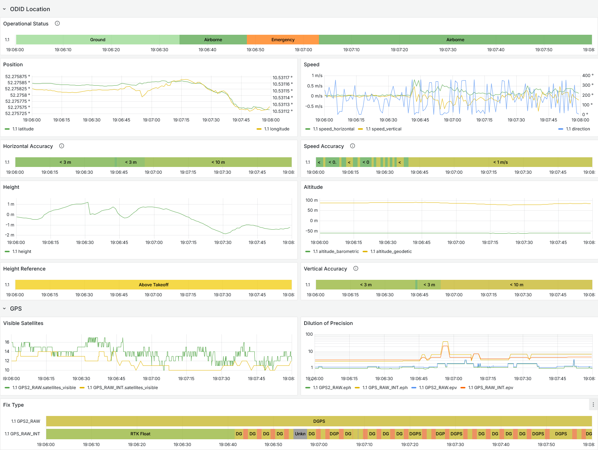

# Loss of GNSS

When the GNSS signal is lost or its accuracy drops below the [COM_POS_FS_EPH] threshold, PX4 has to work without a position estimate.
What happens then depends on the flight mode.

## Altitude Mode

In flight modes not depending on a position estimate, a loss of GNSS will only trigger a warning to the pilot, nothing more.
As no position estimate is required for these modes, flight control is not affected.

!!! info

    In Altitude Mode, the vertical position can be estimated by the barometric pressure sensor, therefore GNSS is not required.
    With GNSS _available_, it will only be used to improve the vertical position estimate.

## Position/Mission Mode

In velocity or position-controlled flight modes, the position estimate is required by the flight stack.
When in a flight mode depending on a position estimate, a loss of GNSS will cause PX4 to enter [Position Loss Failsafe](#position-loss-failsafe).

## Position Loss Failsafe

As stated in the [PX4 documentation][px4-position-gps-loss-failsafe]:

!!! quote "Position (GPS) Loss Failsafe"

    The Position Loss Failsafe is triggered if the quality of the PX4 position estimate falls below acceptable levels
    (this might be caused by GPS loss) while in a mode that requires an acceptable position estimate.

The pilot will be notified, and the drone will enter [Altitude Mode](#altitude-mode) for the pilot to take over control.
As with the [C2 Link Loss](c2-link-loss.md) and [Low Battery](low-battery.md) failsafes, the drone advertises the **Emergency** operational status
while in the failsafe mode.

[px4-position-gps-loss-failsafe]: https://docs.px4.io/v1.14/en/config/safety.html#position-gps-loss-failsafe
[COM_POS_FS_EPH]: https://docs.px4.io/v1.14/en/advanced_config/parameter_reference.html#COM_POS_FS_EPH
[COM_POSCTL_NAVL]: https://docs.px4.io/v1.14/en/advanced_config/parameter_reference.html#COM_POSCTL_NAVL
[COM_POS_FS_DELAY]: https://docs.px4.io/v1.14/en/advanced_config/parameter_reference.html#COM_POS_FS_DELAY

---

## Test Setup

This was tested on a HIGHDRA without arms, normally powered by its flight batteries.
The copter was configured as follows:

| Parameter          | Value | Notes                                          |
| ------------------ | ----- | ---------------------------------------------- |
| [COM_POS_FS_EPH]   | 5     | Failsafe will trigger when error exceeds 5 m   |
| [COM_POSCTL_NAVL]  | 0     | Switch to Altitude mode when failsafe triggers |
| [COM_POS_FS_DELAY] | 1     | 1 second delay before triggering failsafe      |

The test was performed in Position Mode.

1. The drone was armed in Position mode from the Herelink controller, and a takeoff was simulated by lifting the drone up
   by hand and tilting it slightly forward.
2. The GNSS signal was disturbed by carrying the drone into a building. This caused the drone to trigger the Position Loss Failsafe,
   broadcast the **Emergency** operational status, and switch to Altitude mode. The pilot was notified via the Herelink controller.
3. The pilot acknowledged the failsafe condition by actively switching to Altitude mode. This reset the failsafe condition, and the drone
   resumed to **Airborne** status.

## Results

The trace displayed below ([dashboard][grafana-mavlink-loss-of-gnss]) shows the sequence of events described above.

1. At 19:06:34, the drone was armed and took off, entering **Airborne** status.
2. At 19:06:47, the GNSS signal was disturbed, causing the drone to trigger the Position Loss Failsafe.
   The drone switched to Altitude mode, and the status was set to **Emergency**.
3. At 19:07:02, the pilot acknowledged the failsafe condition by actively switching to Altitude mode.
   This reset the failsafe condition, and the drone resumed to **Airborne** status.

[grafana-mavlink-loss-of-gnss]: https://grafana.starcopter.de/d/ae9v33evpjjswa/mavlink-snippets?orgId=1&from=2025-01-14T18:06:00.000Z&to=2025-01-14T18:08:00.000Z&var-datasource=Mig5CVbnk&var-bucket=mavlink&var-logger=$__all&var-session=$__all&var-system_id=1&var-component_id=1&timezone=browser&kiosk

## Bonus: Complete Loss of GNSS

The trace displayed below ([dashboard][grafana-mavlink-complete-gnss-loss]) shows a complete loss of GNSS while flying in Altitude mode.
Even with a complete loss of the GNSS signal, the status remained **Airborne**.

[grafana-mavlink-complete-gnss-loss]: https://grafana.starcopter.de/d/ae9v33evpjjswa/mavlink-snippets?orgId=1&from=1736936460000&to=1736936820000&var-datasource=Mig5CVbnk&var-bucket=mavlink&var-logger=All&var-session=All&var-system_id=1&var-component_id=1
