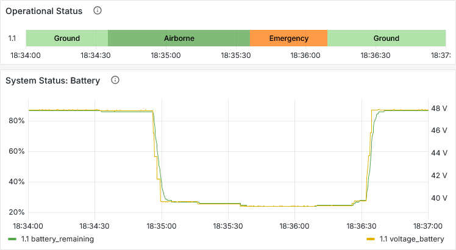

# Low Battery

When the battery percentage reaches the configured critical battery threshold [BAT_CRIT_THR],
the drone automatically enters a failsafe mode and returns to launch.

In this mode, the drone is not in immediate danger, since it still has enough energy left to perform a safe landing.
Still, this is advertised as an **Emergency** status: the drone might deviate from its previous (and anticipated) flight path
to return to the launch position. As long as the drone is in this mode, other pilots are warned to take extra care.

Should the pilot take over control and interrupt the automatic landing, the advertised operational status is reset to **Airborne**.
Since the pilot has full control over the drone, he can react to other airspace users and adjust the flight path accordingly.
Naturally, the pilot should land the drone as soon as possible, to avoid an unplanned forced landing.

When the battery percentage reaches the configured emergency battery threshold [BAT_EMERGEN_THR],
the drone will initiate a forced landing on the spot, and the operational status is set to **Emergency** again.

!!! warning "TODO"

    The emergency trigger has not been tested yet.

## Test Setup

This was tested with a HIGHDRA connected to a voltage controlled power supply, with no arms attached.
The copter was configured as follows:

| Parameter         | Value | Notes                                               |
| ----------------- | ----- | --------------------------------------------------- |
| [BAT_LOW_THR]     | 30    | Copter (and AMC) will warn at 30%                   |
| [BAT_CRIT_THR]    | 25    | Return to Launch if battery drops below 25%         |
| [BAT_EMERGEN_THR] | 10    | Land/Descend immediately if battery drops below 10% |

The test was performed as follows:

1. The voltage was set to 48 V, corresponding to a fully charged battery.
2. The drone was armed, and a takeoff was simulated by lifting the drone up by hand and tilting it slightly forward.
3. Then, the voltage was gradually decreased to around 40 V, which corresponds to a battery level of **26%**.
   Note this is just above the configured critical battery threshold of 25%.
4. After observing for a while, the voltage was further decreased to 39 V, which corresponds to a battery level of **24%**,
   just below the configured critical battery threshold of 25%.
5. After waiting for another minute, a landing was simulated by setting the drone on the ground, keeping it level
   and lowering the throttle to 0. It automatically disarmed, as the FMU detected a landing.

## Results

While the battery percentage was above 25%, the advertised operational status was **Airborne**.
As soon as the battery percentage reached 25%, the drone entered its Return to Launch mode and advertised an
Emergency status. After landing, the drone disarmed and reset the operational status to **Grounded**.

A trace is available on the [Grafana dashboard][grafana-mavlink-low-battery], a screenshot is shown below.

[grafana-mavlink-low-battery]: https://grafana.starcopter.de/d/dedcyqkd0cphcc/dri-operational-status?orgId=1&from=1736876040000&to=1736876220000
[BAT_LOW_THR]: https://docs.px4.io/v1.13/en/advanced_config/parameter_reference.html#BAT_LOW_THR
[BAT_CRIT_THR]: https://docs.px4.io/v1.13/en/advanced_config/parameter_reference.html#BAT_CRIT_THR
[BAT_EMERGEN_THR]: https://docs.px4.io/v1.13/en/advanced_config/parameter_reference.html#BAT_EMERGEN_THR
