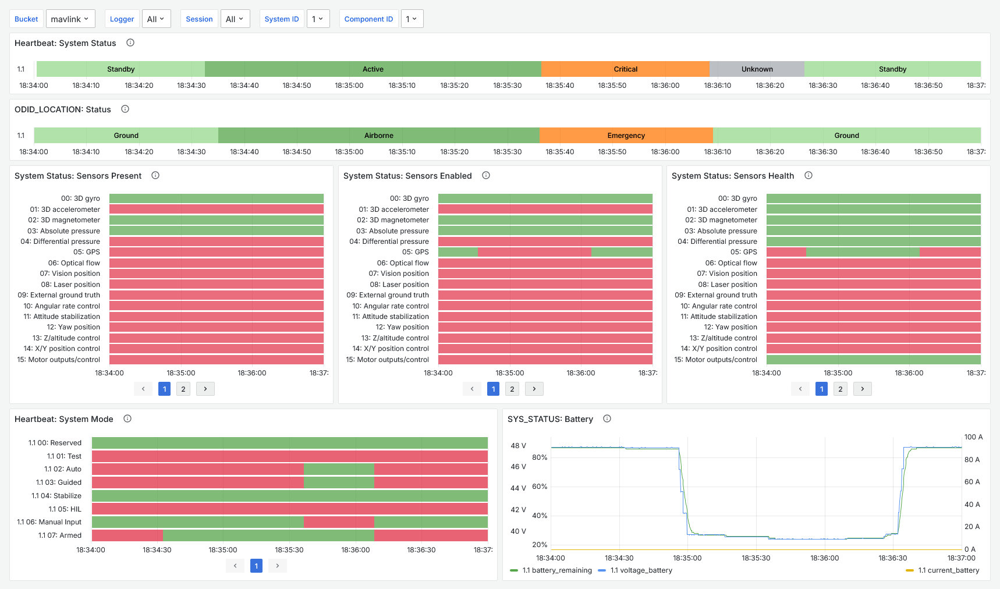

# Low Battery :construction:

When the battery percentage drops below the configured critical battery threshold [BAT_CRIT_THR],
the `status` field in the **OPEN_DRONE_ID_LOCATION (12901)** message sent out by PX4 correctly advances to emergency.

This was tested with a HIGHDRA connected to a voltage controlled power supply. The copter was configured as follows:

| Parameter         | Value | Notes                                               |
| ----------------- | ----- | --------------------------------------------------- |
| [BAT_LOW_THR]     | 30    | Copter (and AMC) will warn at 30%                   |
| [BAT_CRIT_THR]    | 25    | Return to Launch if battery drops below 25%         |
| [BAT_EMERGEN_THR] | 10    | Land/Descend immediately if battery drops below 10% |

A trace is available on the [Grafana dashboard][grafana-mavlink-low-battery], a screenshot is shown below.
As long as the battery percentage is above 25%, the status field is still set to **Airborne**.
When the battery percentage drops below 25%, the status field is set to **Emergency**, and the copter returns to launch.
After landing and disarming, the status field automatically resets to **Grounded**.

[grafana-mavlink-low-battery]: https://grafana.starcopter.de/d/ae9v33evpjjswa/mavlink-snippets?orgId=1&from=1736876040000&to=1736876220000&var-datasource=Mig5CVbnk&var-bucket=mavlink&var-logger=All&var-session=All&var-system_id=1&var-component_id=1
[BAT_LOW_THR]: https://docs.px4.io/v1.13/en/advanced_config/parameter_reference.html#BAT_LOW_THR
[BAT_CRIT_THR]: https://docs.px4.io/v1.13/en/advanced_config/parameter_reference.html#BAT_CRIT_THR
[BAT_EMERGEN_THR]: https://docs.px4.io/v1.13/en/advanced_config/parameter_reference.html#BAT_EMERGEN_THR
